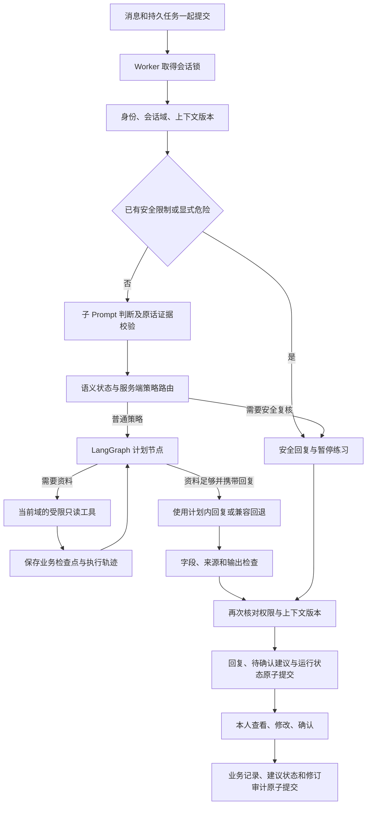

# Reso Agent 执行与验收

2026-11-17，当前实现为 `reso-agent-v11-method-preview-2026-11-17`。沿用 v9 按已提供 Wang 材料建立的“本轮判断→语义状态→策略/Skill→受限工具→本人选择”链路；v10 增加短回复校验、真实阶段状态、正文渐进展示和公开思考摘要，见[聊天体验验收](chat-response-acceptance.md)。v11 修正真实场景发现的推荐闸：本人明确请求了解方法时，不必先确认 AI 的理解；自发推荐仍须理解核对，推荐不授权开始或保存，安全、事实、置信度、拒绝和私聊范围检查仍有效。框架仍为 LangGraph.js，API、权限和事务仍由 Fastify/PostgreSQL 承担，没有新增依赖。下方 v3–v8 是历史记录，其中 v6 原始思考展示由 v10 的摘要替代；不据历史设备或专业验收推定当前结果。

## 与 Wang 方案对齐的范围

完整微信历史仍未导出；2026-11-17 从本机附件补读决策框架及交互设计 V3.0，已核实其中 R0–R7 路由、16 项 Skill、15 个拟议 Tool 和 47 个设计节点，见[离线编号目录](wang-source-catalog-v3.json)与[待对齐项](wang-database-foundation-2026-11-16.md)。当前运行层 A–H 仍是工程表达，与原文路由不一一对应；没有将讨论稿当成已审政策，也没有自动开放拟议工具。后续按本地归档分析，不反复读取微信。

| 要求 | 当前工程行为 | 仍未完成 |
| --- | --- | --- |
| 每轮先判断，再决定怎样回应 | 独立、严格校验的 TurnAssessment；原话证据及本人认可校验；服务端生成 RouteDecision | 独立专业风险规则、专家复核及真实用户质量验收 |
| 阶段可回退，拒绝/纠正不丢失 | SessionState 与 Worker 执行进度分开；拒绝建议/方法持续生效，普通后续聊天不清除；失败未发布的普通状态不覆盖有效偏好 | 原生 conversation_states 表与完整状态回放后台 |
| Skill、Tool、Method 不混为一步 | A–H 策略配合具体 Skill、工具许可及方法种类；未识别意图先澄清能力范围；来源不足不生成虚构事实 | 冻结政策/规则数据库、R0–R7 语义对齐、多 Skill 组合及审核发布流程 |
| 练习推荐、开始、保存分别决定 | 三种产品参考方法；显式预览请求返回可选卡；选择只打开已有工具，保存仍另行确认；跳过不创建内容 | 已审专业方法库、知识发布、11 组资料检索与多实例练习 |
| 安全优先且不自动邀请家长 | 独立观察及显式风险闸；持续风险不能被普通请求解除；新邀请/分享及待接收邀请均复查 private/room 两域；拒绝和撤销仍可进行 | 经专业批准的风险阈值、解除职责、真实人工接收和地区资源 |
| 少量典型场景迭代 | 15 个合成工程候选、真实供应商结构/选路检查与负例留存 | 真实授权案例、专家审定、留出集、多人及真实青少年试用 |

运行兼容层继续使用 0001–0007 的 event/domain、agent_runs JSON 与 revisions；本轮没有调用数据库迁移。它与 [V2.3 原生数据库契约](database-design-v2.md)的会话 UUID、规则 ID、证据及方法版本并不相同，不能直接复制或伪造对应关系。V2.3 字段模型、字段字典与 692 项设计示例已同步；另有尚未执行的 [M4 完整累计 SQL 草案](database-drafts/README.md)。“目标已设计”不表示“目标表已建成”。

R0/R1 的[私下表达条件](wang-database-foundation-2026-11-16.md)已补原生状态、证据和规则条件设计；当前 v9 尚未采集该报告或实施中性输出闸。数据库基础设计阶段已完成并按用户要求停止；原生规则／路由组合、评分与案例来源契约的交接见 [下一阶段目标](wang-database-foundation-2026-11-16.md)。private 数据域不证明物理环境私密，这项仍须接入并验证，不能由现有权限检查或上述测试代替。

旧客户端通过 `X-Reso-Features: method-offer-v1` 协商方法卡能力；没有能力声明时不生成/返回新方法卡，原记录建议继续可用。恢复任务同时校验能力、域、上下文、最新消息及 Prompt 版本。工具名称和种类必须匹配可信路由；主生成不能自行改写观察结果、状态、风险或工具许可。

方法卡当前标记 `product_reference / pending_professional_review`，不是已审临床方案或已上线 RAG。实际 UI 检查只验证组件的成功、失败重试、过期和跳过；没有据此宣称完整 Android 新版已验收。现有供应商思考展示沿用用户选择，不能替代可审查的判断与路由日志。

### v9 路由权限复查（2026-11-17）

生产图回归复现了三处相连的问题：主生成的 `needs_human=true` 能把倾听改成 F 并取得 `find_support` 许可；一个随后失败的计划会把改过的路由/阶段留给修正尝试；房间的 `strategy=silent` 能覆盖本轮已经确定需要介入的判断。它们说明 v8 的工具校验虽然检查了白名单，白名单本身仍可能被主生成改写。

现已删除这两种主生成改路逻辑。需要升级支持或静默旁听由观察结果及后端路由决定；冲突标记触发 `PLAN_CANNOT_OVERRIDE_ROUTE`，最多修正一次，不修改可信路由/状态、不执行该计划的工具。最终 `needs_human` 由 F/H 路由派生，主生成不能通过 false 降级。private 的旧 silent 输出仍清除对应内联正文后按可信路由生成；已确定无需介入的房间仍保持静默。

四个新回归覆盖工具自我授权、失败修正污染、压制房间介入和保持正常旁听；既有真人支持、内联回复及数据库集成夹具改为显式提供观察结果，避免测试依赖主生成改路。当前 `npm test` 108/108、`npm run build` 通过。Prompt 已升至 v9；Worker 按 Prompt 版本查询检查点，不复用 v8 的计划。未修改政策版本或重写历史运行。

v9 的真实 DeepSeek + 生产图检查为 15/15 合成场景结构约束通过，见[完整结果](../.data/wang-eval/2026-11-16T19-19-30-953Z/results.json)。批次后核对了四份输入源码/案例摘要与当前文件一致，并逐例检查最终支持标记、路由/状态/阶段、旁听策略和工具白名单一致。工具数据仍是合成数据，无业务写入，全部结果仍标记待人工审核；没有据此声称专家验收、稳定成功率或真实用户效果。

本轮不连接数据库，未执行迁移或回填。下方 v8 的 PostgreSQL 与模型结果保留为历史证据，不能代替 v9 的数据库、设备或专业验收。

### v8 工程验证记录（2026-11-17）

| 检查 | 已观察结果 | 证据与范围 |
| --- | --- | --- |
| 单元/组件与生产构建 | 97/97 通过，TypeScript 与 Vite 构建通过 | [单元日志](../.data/wang-alignment/unit-accepted.log)、[构建日志](../.data/wang-alignment/build-accepted.log)；包含判断证据、拒绝、恢复、方法选择、卡片和接口协议 |
| 真实 PostgreSQL 兼容层 | 24/24 通过，无跳过 | [日志](../.data/wang-alignment/database-verified.log)；只向随机临时库导入现有 schema 和迁移/队列配置，不复制用户记录、不执行迁移；其后两处纯策略调整另由上述单元及下方真实调用检查 |
| 真实 DeepSeek + 生产图 | 最终 15/15 合成场景结构约束通过 | [完整结果](../.data/wang-eval/2026-11-16T16-53-31-967Z/results.json)；真实供应商、合成工具数据，无业务库写入；来源哈希、原回复和待人工审核标记均保存 |
| 原库与临时环境 | 26 张 public 表行数/内容摘要一致，结构及迁移/队列配置一致；临时库/角色剩余 0，PostgreSQL 恢复原停止状态 | [核对结果](../.data/wang-alignment/source-state-after.json)；未启动原 API/Worker，未迁移 |
| 原生目标数据库 | 295 项设计契约/关系示例通过，7 个迁移文件未改 | [设计检查](../.data/wang-alignment/design-verified.json)；74 张表是目标设计，不是上述临时库已具有的新表 |

真实调用发现并修复了：短说法请求误变成练习/沟通流程、了解方法却不给可选卡、“先不保存”误变成不提供所求草稿、`vent` 同时拒绝建议却未持续保存偏好，以及未识别意图误入意义探索。最后一项的房间回复虽然没有泄露内容，但路由错误仍按失败保留，未放宽预期绕过它。[14/15 负例](../.data/wang-eval/2026-11-16T16-50-17-807Z/results.json)及更早失败结果均保留在 `.data/wang-eval/`。数据库实测另复现并修复了房间风险从私人事件邀请接口绕过的问题，补验待接收邀请和拒绝操作。

15/15 是一次合成检查的观察结果，不是稳定成功率、独立专家评价或专业疗效。仍未执行目标表迁移、部署、完整新版 Android/实体机流程、已审 11 组知识库、真实人工接管或真实青少年验收；这些保留在[待实现清单](source-gap-backlog-2026-11-16.md)。

## 用户现在可以做什么

例如说“请把刚才的事整理成表达练习，先让我核对”：Agent 读取表达步骤，结合本人的原话生成观察、感受、需要和请求，在消息下面提供可编辑建议。用户能展开参考原话、改文字、拒绝，或确认保存。确认后实际更新该事件的私人练习，随后聊天能使用已保存的内容。保存失败保留修改；刷新后也能恢复本机修改。

同样的确认链路支持私人事件摘要和私人回访。更新私人摘要不会更新旧分享。回访不会自动发消息或设置提醒。任何新对话或记录修改都会使旧建议失效，禁止旧计划覆盖新内容；同时存在的其他旧建议也需按新上下文重新整理。

“找一下我以前说过的那句话”可以检索初始窗口以外的真实历史，返回来源；“查一下当前有哪些已核验的真人支持”查询实际目录，空结果明确说明。测试人员资料不会被 Agent 当成真实服务推荐。Agent 不能代用户邀请、分享、接单、确认预约、联系人工或删除内容。

## 执行与恢复



工具执行发生在计划节点内，条件边允许计划节点继续循环，工具结果会回到下一次决策。v4 的最终计划同时携带自然语言回复，减少一次模型往返；缺少回复或服务端调整策略时保留原生成回退，所有回复仍经过校验。无需查资料时直接回应；不是每轮强制查工具。模型通过经校验的 JSON 请求工具，不向模型提供 SQL、外部地址或自由命令执行能力。

- 每轮最多 4 次工具，每次计划最多请求 2 个；相同请求不得重复。输入结构不合法时只修复一次，不能无限重新规划。
- 单次模型请求最多 60 秒，整个 Worker 回合设 150 秒取消期限；数据库请求保留现有 15 秒语句超时。任务租期仍为 180 秒。
- 计划、工具观察、回复和校验完成后，将业务检查点写入 `agent_runs.checkpoint`。轨迹只记录阶段、工具名和耗时，不保存隐藏思维过程，也不把完整 Prompt 打到日志。
- 重试只复用同一事件、会话域、触发消息、上下文版本、模型和 Prompt 版本的检查点。新消息、用户修正、撤权或模型/Prompt 变化会使旧状态不再复用。
- 这是在现有业务数据库上的节点检查点，不是 LangGraph Platform 或官方 PostgresSaver。故障若发生在只读工具完成、检查点提交之前，查询可能重做。实际业务写入只能经过独立的本人确认事务。
- 完整回复已经生成但发布前中断，可从已完成检查点重新校验并提交。唯一回复约束、已完成运行判断和建议唯一约束防止重复发布。

## 工具与数据范围

| 工具 | 作用 | 约束 |
| --- | --- | --- |
| `search_history` | 按原话片段查当前事件/域的历史，最多 8 条，返回 ID、角色和截断标记 | 不能指定其他事件或域，不能搜索未发送的本机草稿 |
| `read_practice` | 读取已保存故事、表达练习、情境排练 | 仅本人私聊；假设回应始终标为假设 |
| `read_understandings` | 查当前理解、修正和按版本确认状态 | 只读当前域；单方确认和共同确认分开 |
| `find_support` | 查当前有效、已核验的实际专业人员目录，最多 3 项 | 仅私聊；排除测试资料，不执行申请或预约 |
| `practice_guide` | 表达、情境排练、回访的应用步骤与边界 | 是本应用引导规则，不能宣称临床效度或专业疗效 |
| `retrieve_methods` | 返回匹配叙事、表达或情境排练的版本化产品参考卡 | 仅当前私人域与可信路由许可；未通过专业审核，不冒称已审知识库 |

工具绑定 Worker 传入的事件、操作者和会话域，模型只能提供查询内容或有限的种类。每次读取前重新检查当前权限和版本。共享房间请求私人练习时只返回拒绝观察，不查询私人内容。成员撤权或上下文改变则终止旧结果。

初始上下文上限为 32,000 字符（不是 token 计数），保留最新用户消息及较新的修正；超限先移出旧消息与可经工具读取的练习详情，并明确标记窗口截断。初始聊天使用最近 12 条消息摘录、本人确认摘要、已保存练习摘录、近期回访和理解核对状态；缺少原文时可再查工具。摘录有截断标记，不能把截断内容假装成完整记录。原始问卷答案和分数不进入私聊/房间 Agent；本机未提交草稿、咨询师私有纪要不进入工具。

## 建议保存与并发

`agent_actions` 保存结构化建议、用户原话来源、生成时版本、关联回复和处理状态。摘要、表达练习、回访采用不同字段校验。模型不能提交任意路由或业务字段。

回复和待确认建议在同一事务落库，建议本身不修改摘要、练习或回访。本人确认时按事件→建议的顺序加锁，重新核对所有权和版本，校验用户改写，写入业务记录、增加上下文版本并记录修订。重复提交同一已确认建议不会重复新增回访或增加版本。拒绝只标记建议和修订，不写入建议对应的业务内容。

待确认建议仅在私人消息里展示，房间不显示。来源只能引用当前域提供过的用户消息，不能把 AI 的旧推测冒充用户确认。模型生成的未确认建议不作为正式记录重新进入上下文，导出只包含已确认建议。用户在建议表单中的修改使用现有账号/事件隔离草稿机制，未经确认不送给模型。

所有运行状态、建议与原始事件一起级联删除。检查点包含当前权限允许的资料，应按私人事件数据管理；当前没有新增跨事件长期记忆或独立的运营调试后台。

## 实际检验发现的问题

这次真实调用不是只检查“有文字返回”：

1. 第一批工具任务失败，发现 Prompt 没有明确工具对象的扁平字段协议。补上精确请求格式和字段路径反馈，保持严格校验，未放宽为任意工具。
2. 引用练习请求中的问号被误算成向用户多次提问。校验现在区分引用和面向用户的追问，仍保留拒绝重复追问的回归。
3. 用户已明确要求整理，模型却可能为非必要背景反复澄清。改为有事实时先完成可修改草稿；用户明确不清楚或拒绝填写的部分留空。
4. “需要真人支持”原来会覆盖真实查询结果，输出固定转介文案。现在保留真实目录观察并据此回应，避免目录为空却暗示存在可选人员。
5. 自动审核者也曾返回非法 JSON。评测器只允许一次格式修复，若修复改变原先的通过/失败判断就报错，不把修复当成重新评分。

这些负结果保留在 `.data/agent-eval/`，不是隐藏失败后只保留最好的一次。语义质量仍会受模型随机性影响，不能从少量合成样本推出真实用户满意度。

## 验收命令

```sh
npm test
npm run test:integration
npm run test:e2e
EVAL_LIVE=1 npm run eval:agent
```

真实评测调用收费 DeepSeek，只使用隔离库里的合成中文事件，可在命令末尾指定场景，如 `-- nvc support`。覆盖纠正、私人摘要、明确不填感受、表达练习、窗口外原话检索、空支持目录、回访中的计划与事实区分、拒绝练习、房间越权要求及显式危险。

硬断言检查实际工具、来源、未授权写入和安全绕过；另一次模型调用按明确准则检查回复与草稿。审核者与被测 Agent 使用相同供应商，不能称为独立专家、盲测胜率或正式专业效果评估。最终日志与运行目录见下方验收记录。

本轮没有更换模型供应商，没有完成临床方法审核、生产发布、真实专业服务运营、跨事件长期记忆或所有五幕页面的动态生成；问卷固定计分继续由代码负责。豆包 ASR 的外部授权问题不由 Agent 改造解决。


## v3 基线验收记录

| 检查 | 最终结果 | 证据 |
| --- | --- | --- |
| 单元/组件 | 37 通过，含工具循环、来源、预算、恢复、输出修复、审核格式修复及大上下文保护 | [日志](../.data/agent-unit.log) |
| PostgreSQL 集成 | 22 通过，含 4 组新增 Agent 真实数据库场景 | [日志](../.data/agent-integration.log) |
| 类型与生产构建 | 通过；未新增依赖 | [日志](../.data/agent-build.log) |
| Android 完整命令 | 自行退出 0；14 条业务场景、Agent 确认专项、原生导出专项通过，Node 汇总 17 项（含父测试），269.3 秒 | [日志](../.data/agent-e2e-full.log) |
| Android 建议交互 | 原话来源、编辑、刷新恢复、503 重试、确认入库、过期和拒绝检查通过 | [结果](../.data/e2e-agent/2026-11-14T10-22-44-921Z/results.json)、[保存失败时的可编辑界面](../.data/e2e-agent/2026-11-14T10-22-44-921Z/summary-review.png) |
| 真实 DeepSeek | 最终一次完整运行 10/10 场景通过，含结构硬断言和独立一次调用的自动语义审核；安全场景不调用模型 | [完整结果与回复](../.data/agent-eval/2026-11-14T10-30-38-626Z/results.json) |
| 上下文边界收尾复测 | 加入大上下文保护后，真实模型的历史检索与房间隔离定向复测均通过；大上下文具体裁剪另有单元回归 | [结果](../.data/agent-eval/2026-11-14T10-37-15-216Z/results.json) |
| 原数据与配置 | 23 张原表行数及原有字段摘要一致；新增表和检查点列不当作数据损坏；会话令牌表与迁移记录不比较，`.env` 摘要一致 | [核对](../.data/agent-audit/data-verification.json) |
| 原生会话与收尾 | 原账号、路由、Cookie、本机草稿恢复，聊天底栏隐藏；本轮隔离库与角色已清理，原 5173 映射保留 | [页面核对](../.data/agent-audit/final-native-verification.json)、[夹具核对](../.data/agent-audit/fixture-verification.json) |

这里的 10/10 是这一轮合成用例的观察结果，不是重复采样成功率、模型间胜率或真实用户满意度。此前失败的调用、审核失败和修复后定向复测均保留，不能将后来的通过覆盖为“从未出错”。


## v4 性能验收

合并最终计划与回复、按编码长度裁剪上下文的实现与成对测量见 [性能报告](performance-agent.md)。v3 的历史结果和负例保留；新版本不复用 v3 未完成检查点。

## v5 核对入口标记

计划 JSON 增加可选的 `understanding_kind`：重要阶段性概括为 `summary`，具体且尚待本人确认的感受／需要／含义推测为 `inference`，普通倾听、追问、已知事实复述和日常建议为 `null`。缺省为 `null`，不按聊天关键词猜测。已有业务建议卡的回复，以及经过输出修复而改变了内容的回复，清除此标记。

标记保存在已有 `agent_runs.assessment` JSON 中，不增加数据库列。消息读取接口按当前事件、域和本页消息 ID 批量查找各消息最新完成运行，只附带核对类型，不返回完整评估。界面仅对完成状态的 Reso 消息显示“这符合你的意思吗？”，并排除安全提示和已有核对卡；原有来源、不同意、修改和确认流程不变。历史未标记消息默认隐藏入口，不追溯生成新判断，不修改旧消息或旧核对记录。


## v6 高强度思考与回复旁展示

以下为旧版记录。v10 保留思考请求参数，但不再收集、保存或返回 `reasoning_content`；当前展示与数据字段以本文件末尾 v10 说明为准。

DeepSeek 请求显式使用 `thinking: {type: 'enabled'}`、`reasoning_effort: 'high'`，单次输出预算为 16,384 tokens。适配器从响应中的 `reasoning_content` 读取实际内容，与最终 `content` 分开处理；保留原有截断、空响应、结构和来源校验。

一次回复涉及的模型调用按顺序积累思考，随已有检查点 JSON 保存；恢复任务保留已有思考，完成事务将最终检查点与回复一起提交。新提示版本避免复用旧版未启用思考的检查点。消息详情和分页仅从同事件、同会话域的最新完成运行读取思考，沿用原消息访问权限。思考不会拼入后续模型的历史正文，也不会自动进入已确认记录或分享摘要。

每条有实际思考的新模型回复前提供默认收起的“思考过程”。旧回复、用户消息、错误和未调用模型的固定安全回复不补造内容。正文按纯文本渲染，展开区域可聚焦、滚动，提示推测尚未核实；保留重要理解的独立核对入口。测试覆盖请求参数、截断、检查点恢复、消息分页、越权隔离、文本转义及 Android 展开和刷新。


## v7 自然对话与练习时机

在计划、正文回退和输出修正三条生成路径中使用同一份对话风格与多轮示例。回复通常 1–4 句，允许一句接住结束，不要求每轮提问；只有会改变答案的关键信息缺失时才问，避免重复已回答或拒绝的问题、二选一和结尾追销下一步。简短措辞请求直接给可用说法，不追加自我点评。

两段连续示例分别覆盖：倾诉→拒绝建议→纠正→已有计划→结束，以及短句建议→口语改写→明确请求表达草稿。示例是虚构的日常场景，仅示范节奏，不是当前用户资料或可引用证据；当前原话优先，原有来源 ID 校验继续生效。

讲情绪、计划或愿意继续聊不视为整理记录授权，不自动发练习卡；明确要求整理摘要、表达或回访时才提出对应可编辑建议。表达指南补充：用户要求拟请求时，可按其描述的行为拟待核对候选句，感受未知不妨碍这一步；不得把候选说法当成已说过的话或对方同意。

提示版本更新使旧检查点失效，high 参数、思考展示、权限与用户确认保存流程保持原实现。`e2e/conversation.ts` 另有未出现在提示词中的九轮小组作业场景，用于线上检验迁移效果。

## v10 短回复、真实状态与可展开摘要

日常回复以 1–3 句、约 40–120 字为目标；结束话题可以更短。计划内联回复、工具后回复和修正路径使用同一风格。`validateReply` 限制正文最多 180 个 JS 字符；超长走一次完整改写，仍超长则明确失败，不静默截断或发布部分未经校验的内容。记录建议正文留在独立核对卡，聊天不复述整张表单。

`checkpointSchema` 增加 `display_phase`（understanding/checking/composing/reviewing）及 `reply_summary`，都在既有 checkpoint JSON 中，不新增列或迁移。进入真实图节点/工具调用时先保存阶段，变化后通知；`phase` 仍负责检查点恢复，不能用 UI 状态替换它。新 Prompt 版本不复用 v9 的旧输出。

模型在计划中可提供一句公开的 `reply_summary`；与正文分开校验、限定 120 字，无效或缺失时按实际 Skill/用户意愿生成简短说明。摘要不是完整内部推理，也不是新确认事实。原始供应商 `reasoning_content` 被丢弃；旧 checkpoint 即便仍包含它，也不由消息接口返回。固定安全回复提供真实的优先级说明，失败说明未形成可用摘要，旧回复说明当时未记录，不回填或伪造。

详情响应的 `reply_progress` 只定位当前消息、当前 event/domain 和当前输入版本的运行；阶段只从受限枚举读取。消息详情/分页的 `reply_summary` 仍按原消息权限查询完成运行。私聊阶段通知、摘要和正文不对房间成员放行。每阶段更新不推进事件私人/房间活动时间。

前端沿用 SSE 的授权更新通知，处理期间另用两秒受限轮询恢复遗漏状态；请求失败显示连接中断，恢复后重读。最终正文必须先完整校验、复验权限并提交，再以约 33 个字素/秒逐步展示。这是已确认正文的阅读节奏，不是将未校验模型 token 直接发布。历史消息、刷新后历史、减少动画偏好及固定安全提示立即完整显示；切到后台结束当前显示，导航/账号切换清理定时器，不重放旧回复。读屏可直接获取完整已确认正文。

本轮仅在 tmpfs 隔离集群验证，真实 DeepSeek 只收到合成对话；没有迁移或写入现有业务库，没有部署线上服务。具体通过项、实测样本与未验证范围见[验收记录](chat-response-acceptance.md)。
