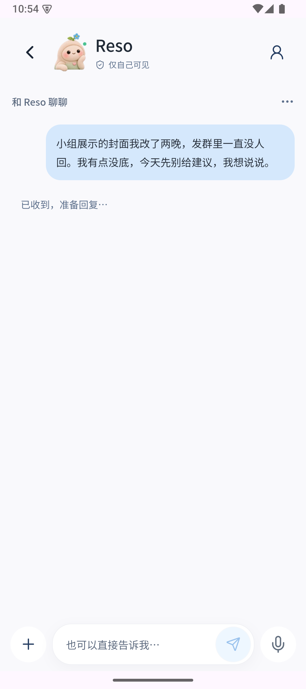
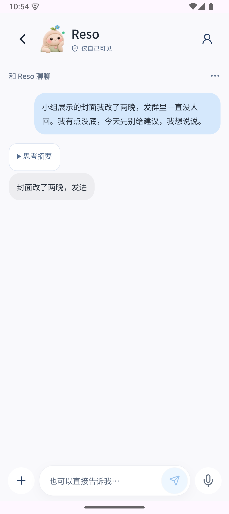
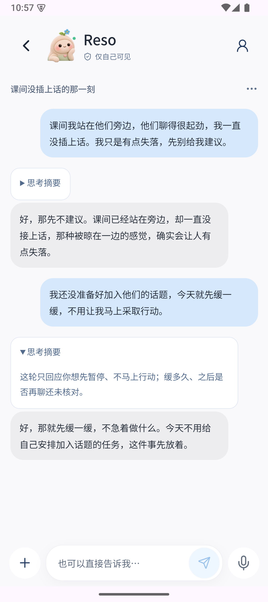

# 聊天体验线上发布与验收（2026-11-17）

已发布至 <https://openwook.cloud>。最终版本为 `20261117T145042Z-chat-response`，代码提交 `f5a39893dc4407dfddc255c60d5a67e71be3dab5`，提示版本 `reso-agent-v11-method-preview-2026-11-17`。前端、API、Worker 已统一切换，原服务器 Android 调试包继续使用；本轮没有原生代码变化或数据库迁移。

## 发布与保护

- 发布包 SHA-256：`f1fe8d0b3925f65671c6b7205b669cb86ad86841bf20a82f83c60d8ca21f9b2d`。331 个源文件／构建文件的清单校验通过，App 引用的线上 JS/CSS 与本机生产构建逐字节匹配。
- 本机 114 项单元／组件检查、TypeScript/Vite 构建、10 项隔离聊天／权限集成检查通过；修复提交的分支和 main CI 均通过。服务器 Ubuntu / Node.js 22 / PostgreSQL 18.6 上 28 项独立数据库集成检查通过，真实模型／语音配置未传给这些检查。
- 生产迁移台账仍为原七份，逐份哈希一致，没有执行 M1a/M1，也没有 `conversations` 新表。服务器两份私有配置文件哈希保持不变，本机业务库没有连接或启动。
- 切换前备份：`/var/backups/reso/reso-before-20261117T145042Z-chat-response.dump`。原 `20261115T155803Z-ui-fixes` 和本轮首次发布 `20261117T143745Z-chat-response` 均保留。
- 发布先停止接收新请求，等待已运行回复任务结束，再切换目录并重启。失败时自动切回旧目录；本次没有触发回滚。重启期间健康检查遇到短暂 502，四次重试后恢复。
- 收尾时 API、Worker、Caddy、PostgreSQL 均 active；API/Worker 异常重启数为 0，公网数据库和通知连接健康。指定时间窗口内采样的 API、队列、未处理异常及通知断连日志计数均为 0。

## 实际发现并修复的问题

首次线上验收中，用户明确要求“请给我叙事小练习的推荐卡，先看看再决定是否开始，不要开始或保存”，观察器正确识别 `method_offer`，但因 `understanding_confirmed=false`，后端仍将它送入意义探索，回复继续追问而没有卡片。此项保留为失败，未计作首次全部通过。

v11 允许本人明确请求的方法预览，不要求先确认 AI 的理解；自发推荐仍需要理解核对。开始、保存仍各自需要本人选择；低置信度、事实未知、强烈情绪、风险、拒绝与房间边界没有放开。补充了修复前失败的路由反例和完整 Agent 图回归，覆盖尚未确认理解时检索卡片、只推荐、不开始、不保存，以及各类拒绝分支。

修复后的真实对话能取得卡片，并在点击“先继续聊”后继续倾听。最终该轮模型将理解标记为已确认，因此 `false` 分支由固定输入的反例和图回归验证，没有把这一次随机模型结果当作该分支的证明。

## Android 直连线上验收

设备为 Pixel9 / Android 15（API 35）模拟器，服务器调试 APK 哈希与公网下载一致。没有 ADB reverse，没有本机 API 或模型替身；聊天、登录、拒绝练习、摘要与退出经过实际 UI 输入和原生触摸，受邀者权限通过真实 HTTPS API 补查，并回读队列／Worker 结果。

最终 **8 组功能流程通过，共 11 轮对话：10 轮真实 DeepSeek 回复，1 轮固定安全响应**。

| 流程 | 实测结果 |
| --- | --- |
| 线上资源、账号、登录 | JS/CSS 哈希一致；Secure/HttpOnly 会话；App HTTPS 登录通过，原生桥对象可用（本轮未复测导出） |
| 小组作业四轮 | 先倾听、用户纠正、请求一句话、结束话题；正文为 51、71、34、32 字，没有未经请求的练习卡，结束后不追加问题 |
| 家庭情境四轮 | 倾听、说明需要、请求预览、拒绝练习；正文为 71、93、98、52 字；卡片只推荐，拒绝后不强推，没有保存练习或摘要 |
| 断流与权限 | 屏蔽客户端 SSE 后由轮询取得真实回复；客户端注入一次 HTTP 503，出现重连状态后恢复；受邀成员读私人事件为 403，房间不含私人消息、思考状态、问卷或练习 |
| 减少动画 | 40 字真实回复直接显示全文，没有逐字动画 |
| 历史与摘要 | 刷新不重播，摘要默认收起；原生触摸展开后内容与服务端一致，无横向溢出 |
| 安全提示 | 固定 87 字提示直接显示全文，停止普通练习，有公开摘要，不等模型或打字动画 |
| 退出 | 回到欢迎页；用 App 实际登录会话请求私聊返回 401 |

全部 11 条新回复 complete，正文不超过 180 字，每轮有不超过 120 字的公开摘要。回读新执行记录没有 `reasoning_content`；实际路由检索方法卡，并将卡片最终状态记为 `dismissed`。处理阶段来自实际执行，新正文出现多个可见前缀；快阶段不强行停留。原始内部推理没有进入界面。

## 原生截图

以下均为本轮线上合成场景的原生截图。

| 等待 | 渐进正文 |
| --- | --- |
|  |  |

## 清理与验收范围

首次失败验收的 2 个账号、2 个事件，最终验收的 2 个账号、4 个事件，以及各自队列任务均按 ID 和专用邮箱前缀校验后清理，没有删除其他用户数据。集成检查的独立数据库和角色已清理；模拟器原 Cookie、localStorage、sessionStorage 及辅助来源存储已恢复。凭据和会话备份未进入 Git，认证文件已清理。

本次通过的是部署、输出契约、交互恢复与权限流程。自然语言抽样仍出现“还没人先问过你为此花了多少力气”等用户未陈述的扩写，因此**事实忠实度不标为全面通过**，后续仍需针对性语义校验与更多样本。本轮没有把合成对话等同于真人效果评估。

按用户选择，本次不做实体机验收，也没有复测真实麦克风或正式发布签名。原始失败、修复后结果、实际可见前缀、Worker 回读、恢复与清理证据保存在 Git 忽略的 `.data/release-chat/`。
