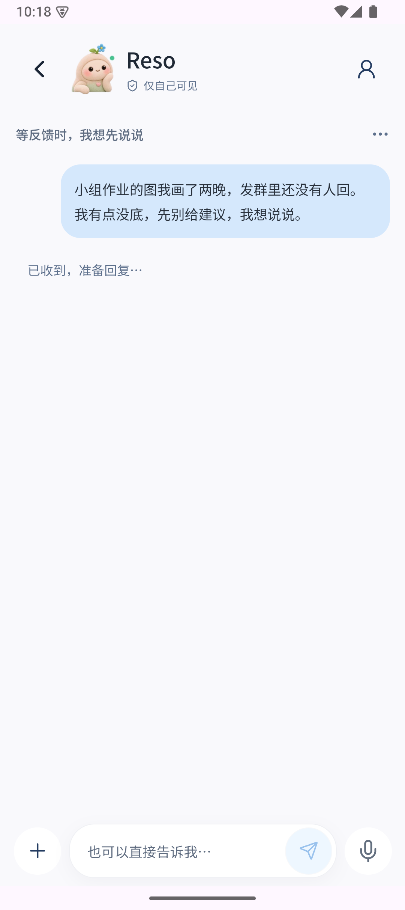
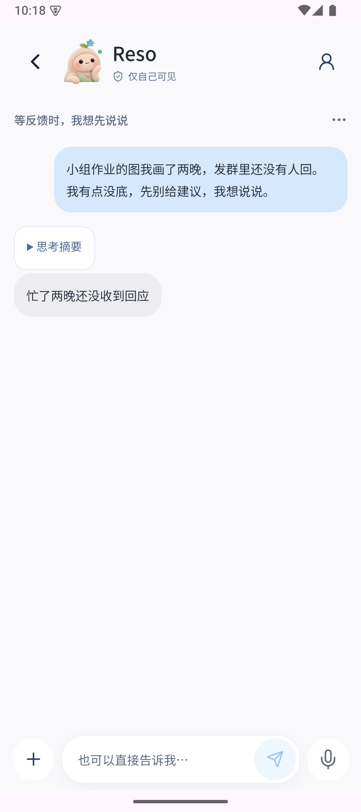
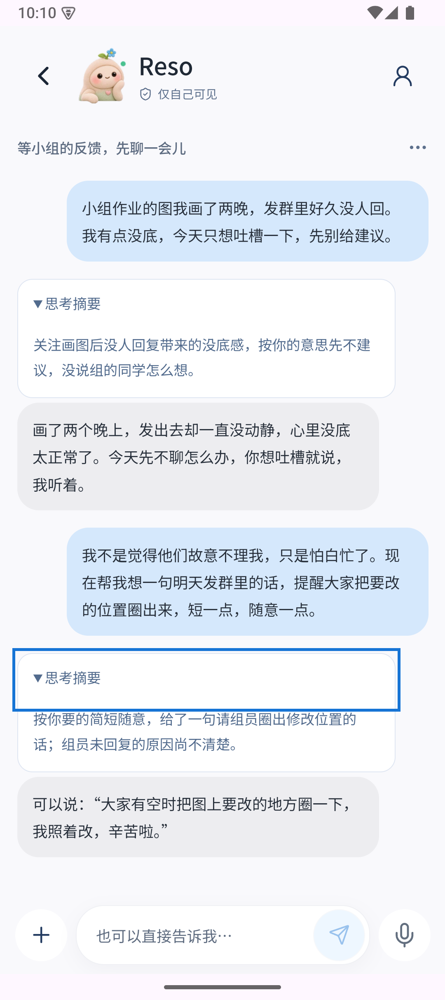

# 聊天回复体验验收（2026-11-17）

日常回复以 1–3 句、约 40–120 字为目标，暂停或简单请求可以更短；服务端上限为 180 个 JavaScript 字符。超长或不合规回复最多修正一次，仍未通过则进入可重试的失败状态，不截断后直接发送。

等待期间展示当前实际执行的阶段：理解表达、核对信息、组织回复、检查表达。阶段由 Worker 的检查点驱动，不增加假等待或虚构思考进度；没有工具检索时不会展示“核对信息”，很快完成的阶段可能不在屏幕停留。

正文先经过完整校验和最终权限检查、提交到数据库，再以约每秒 33 个可见字符逐步呈现。这是已确认正文的渐进展示，不是模型未校验 token 的实时流。新回复播放一次；历史、重新进入或刷新不重播。减少动画、切到后台及固定安全提示会直接显示全文，读屏也能取得完整正文。

每轮回复附带默认收起的“思考摘要”，说明本轮关注点和待核对之处。公开摘要与模型内部推理分开，新执行不保存或返回 `reasoning_content`。摘要缺失或不合规时使用实际路由对应的说明；历史回复和失败回复明确说明当时没有可用摘要，不补造历史推理。

## 已执行的检查

| 检查 | 结果 |
| --- | --- |
| `npm test` | 112 项通过 |
| `npm run build` | TypeScript 与生产构建通过 |
| `npm run test:m1:isolated` | M1 的 16 个场景及 27 项现有后端集成检查通过，涵盖隔离迁移、回填、回滚和权限 |
| 数据库设计和 JSON 契约校验 | 76 表、919 字段行、294 个 JSON 示例及 398 个语义用例通过；7 个原迁移哈希保持不变 |
| SQL 草案自检 | 243 个反例变异全部拒绝；两个增量分别核对 119、235 条 SQL 语句 |
| Android 调试 App，Pixel9 / API 35 | 渐进正文及刷新、减少动画、SSE 中断后轮询与 HTTP 失败恢复、失败重试、固定安全提示五类场景通过；摘要默认收起且可展开 |
| Android 系统设置 | 130% 字号与夜间系统模式下无横向溢出，已核对原生可见窗口，结束后恢复设置 |
| 真实 DeepSeek + App | 三轮合成对话通过，正文分别为 46、32、42 字；可见真实阶段和多个正文前缀，每轮有公开摘要，结束话题后不追加问题 |

真实模型只使用合成的“小组作业等待反馈”对话，覆盖先倾听、按请求代写一句话、用户结束话题三个目标。这些结果证明该次调用及界面链路正常，不代表所有场景的回答质量或临床效果已验收。

## App 截图

等待与渐进片段来自可控供应商替身，用于稳定复现界面；最后一张来自真实 DeepSeek 对话。截图均为本次模拟器原生截图，内容为合成数据。

| 等待状态 | 正文逐步出现 |
| --- | --- |
|  |  |



## 复现与隔离边界

```sh
# 新建并清理一次性 PostgreSQL 集群，验证后端与权限
npm run test:chat:isolated

# 已安装并启动本地调试 APK 的 Android 模拟器
npm run test:chat:isolated -- --app

# 显式调用真实供应商，产生模型费用；只转交模型配置
npm run test:chat:isolated -- --app --live
```

专用容器使用随机凭据、随机回环端口和 tmpfs，没有持久卷；执行前核验容器标签、数据库 URL 和隔离标识。测试使用独立合成账号和真实 HTTP、队列、Worker，结束后清理容器并恢复 App 会话、存储及设备设置。详细样本留在被 Git 忽略的 `.data/chat-experience/`，不发布会话或凭据。

本次功能复用现有检查点 JSON，没有新增数据库迁移；原有业务容器状态、挂载、`.env` 哈希及七份原迁移哈希与执行前一致。未连接或迁移现有业务库，未部署线上服务。实体机、TalkBack 完整流程及更多真实使用场景尚未验收。
