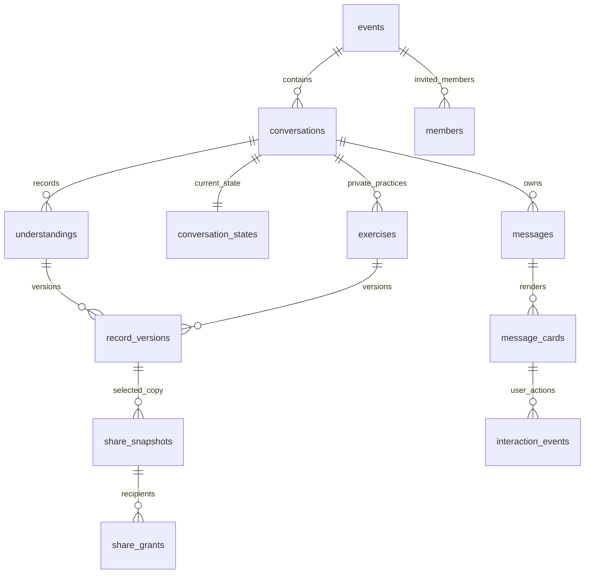
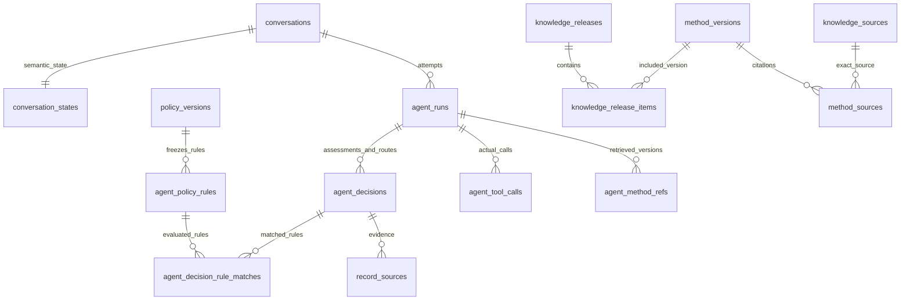
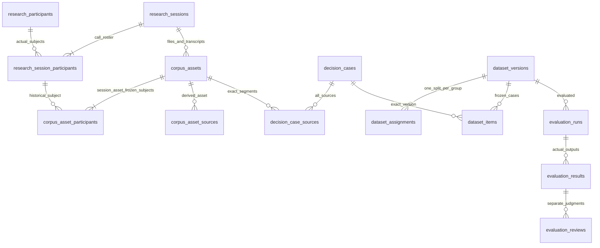

# Reso 数据库目标设计 V2.3

日期：2026-11-16。基线：当前工作区的业务迁移 `0001–0007`、权限实现及[64 项交付清单](source-gap-backlog-2026-11-16.md)。**本稿完成数据库设计，不表示表已创建、迁移已执行或相应功能已实现。**

配套[完整字段字典](database-field-dictionary-v2.md)列出字段 SQL 类型、可空性、默认值、引用、唯一约束、查询索引、权限和删除行为。本稿解释模型、关键不变量、事务及旧数据怎样承接。V2.1 修订了复查的 10 处缺口；V2.3 修复独立审查的 9 处问题（阶段范围、多人研究通话、反馈、题号、角色、签署、推荐快照和回访来源）；V2.2 按已提供的 Wang 材料补齐规则、决策与练习选择基础，见 [Wang 基础补全](wang-database-foundation-2026-11-16.md)；字段模型以 [database-model-v2.json](database-model-v2.json) 为可维护源，字典及第 18 节映射由检查脚本生成。配套 [JSON Schema](database-json-contracts-v2.json)、[正反例](database-contract-examples-v2.json)和[修订复查记录](database-design-review-2026-11-16.md)。

## 1．设计范围与取舍

目标清单覆盖现有 21 张业务表：17 张扩展／重构，`questionnaires`、`perspectives`、`note_shares` 计划切换后退役，`consent_records` 仅保留历史用途。另设计 55 张新表，目标清单共 76 张，分四期落地。认证表、迁移表和 pg-boss 内部表不计入这些业务表，不重建。

| 阶段 | 新表数量 | 先解决的问题 |
| --- | ---: | --- |
| M1 分域、身份、安全和决策基础 | 20 | 同一事件多人的私人空间、有效同意、可追溯版本、持续安全状态、运行失效、操作审计与资料请求 |
| M2 测评、卡片、练习和方法库 | 11 | 多次答卷、可纠正发现、多实例练习、消息内卡片、已审方法发布和检索依据 |
| M3 人物、专业服务和通知 | 10 | 私人人物档案、真实可约时间、预约防冲突、服务记录、通知送达和有依据的保留例外 |
| M4 研究资料和决策评测 | 14 | 受访者／通话／文件分开计数、授权脱敏、专家样例、防泄漏划分、人工与模型评审分开 |

分期有依赖：M1 中指向研究参与者、专业纪要、知识发布等后续对象的可空列／外键，随相应阶段建立目标表后才增加；不为满足字段字典而提前建立空业务系统。每期还需拆为小迁移，不对应一个巨型迁移文件。

例如 M1 的 record_versions 先承接理解；练习实例 ID 与方法引用在 M2 增加，专业纪要归属在 M3 补齐；研究主体及访谈范围的 consent 列在 M4 增加。阶段内只开放已具备处理流程的 kind/purpose，不能因为目标字典已有代码值就让客户端提前写入。

2026-11-17 的 [M2 累计审阅草案](database-drafts/README.md)已包含 M1/M2 的 31 张新表、14 张既有表 126 个新增列；保留旧 exercises 的 event_id 主键，未实施回填、切换或迁移。M1a/M1/M2/M3/M4 为同一基线的替代草案，不能连续执行。方法正文、完整来源及知识发布的确切冻结摘要见 [Wang 基础说明](wang-database-foundation-2026-11-16.md)。

当前 [M3 累计草案](database-drafts/README.md)继续覆盖人物、专业支持、预约和通知，合计 41 张新表、17 张既有表 148 个新增列；含两条预约排他约束及尚未安装的 btree_gist 依赖。五份草案均替代审阅，不连续应用；实际扩展、数据回填、业务事务和应用切换仍未执行。

最新 [M4 完整累计草案](database-drafts/README.md)覆盖全部 55 张目标新表及 17 张旧表 148 个新增列，包含 14 张研究/评测表，已消除跨阶段悬空字段。五份文件是替代审阅版，仍未执行；仅完成扩展列和结构，不解除旧域/主键/来源约束或切换调用方。

保留 PostgreSQL、Drizzle SQL、Better Auth 和 pg-boss。初期不增加向量服务、独立聊天数据库、通用 ACL 表达式、角色继承系统、临床诊断表或每种心理学流派一套表。所有流派共享版本化方法；固定题本和有界步骤使用有明确 schema 的 JSONB。

视频、支付、实时双向语音没有在清单中定为本期必做，本稿也不提前设计 RTC 房间、订单、支付流水或录音归档。当前 ASR 音频仍不自动落库，本机未保存草稿仍留在设备。

## 2．先把事件、会话、所有权和可见性分开

`events` 是一件事的共同主题，不是一个可以读取所有参与者数据的“总文件夹”。`conversations` 才是消息、状态和模型输入的主要分域单位。

| 会话 kind | 所有者与参与者 | 存什么 | 不允许的隐式读取 |
| --- | --- | --- | --- |
| intake | 该初步了解的本人；专门获准的初步了解服务 | 问卷交互、正式答卷、分量表、待核对发现 | private、room、专业 Agent 不直读原题回答或原分数 |
| private | 该私人空间本人 | 私聊、私人练习、理解、摘要、回访 | 原事件发起人不自动读取家长的 private；家长也不能反向读取孩子 private |
| room | 当前有效事件参与者，受历史可见范围限制 | 公共发言、已获准分享、分别确认的视角和共同结果 | 不读任何参与者 private/intake，也不自动读咨询纪要 |
| professional | 具体服务申请人和分配的有效专业人员 | 获准服务沟通、纪要版本及开放状态 | 专业身份不授予读取事件所有私聊的权限 |

每事件一间 `room`；每位参与者可分别有一间 `intake` 和 `private`；每申请最多一间 `professional`。沿用 `members` 保存受邀参与资格，事件原发起人由 `events.owner_id` 表示，不重复增加 owner 成员行。

私人标题放在 `conversations.title`；公开标题使用 `events.room_title`。原 `events.title/summary/initial_summary/private_version` 在兼容期只表示原所有者的数据，随后退出主读路径。任何列表、更新时间、SSE 事件都不能因另一位参与者私聊而向房间泄露活动。

会话归属与当时能否私下表达分开：原生 `SessionState/TurnAssessment.expression_privacy` 保存本人自报、真实原话来源及本轮复验的输入版本。未知、旧报告未复验或另一位发言人的报告不能当作当前私密环境；表达条件也不能替代访问授权、意愿或安全检查。具体来源与中性输出约束见 [R0/R1 补充](wang-database-foundation-2026-11-16.md)。它仍是待接入的目标契约，当前兼容层没有这一原生闸门。



## 3．公共字段和约束约定

- 新业务 ID 使用 `uuid`，默认 `gen_random_uuid()`；保留旧消息 `bigint` ID 和认证 `text` ID，不批量改号。时间用 `timestamptz`，以 UTC 存储、按本人时区显示。金额若出现使用最小货币单位整数和币种；未知费用为 NULL，不冒充免费。
- mutable 根记录使用 `revision` 做乐观锁；不可变正文使用独立版本行。`updated_at` 不是版本号，也不代替原始发生时间。确切历史时间未知时保留 NULL 或导入标记。
- 普通状态用 `text + CHECK`；受专业／地区／版本规则控制的年龄带、风险、阶段和策略代码通过其冻结政策版本校验，不在数据库里写死未经审定的临床阈值。
- JSONB 只保存有界结构：题目和选项、分量表定义、练习内容、模型判断、方法步骤等。每个原生 JSONB 字段绑定冻结的 schema；有版本列的按已登记版本分派，其余按 v1 固定契约。V2.2/V2.3 变更的字段使用 v2，v1 冻结定义仅用于历史读取／显式导入；新写入必须用当前版本。无版本列的字段发生破坏性升级时，必须先加版本列／显式转换，不能借部署静默改变旧值含义。未来服务端用现有 Zod 在写入边界落实相同规则；这些目标表契约本轮未接入运行代码。身份、用途、状态、归属、时间、版本、核心引用必须有普通列。
- 正文哈希不包含会变的状态／审核时间；JSON 内容使用固定 schema 的稳定序列化，原始文本和旧快照保留原字节，不为计算哈希擅自改写或归一化原话。
- 共享和授权依赖真实外键，不使用任意 `resource_type + resource_id` 作为读取权限。去内容审计的定位标识可以采用这种形式，因为它不参与业务读取或授权。
- 同域关系使用复合外键，例如 `(conversation_id,message_id)`，防止两个单列 FK 各自合法但消息来自别人的会话。引用方使用的父键必须是完整 UNIQUE／PK，不能引用只在部分索引中唯一的集合。
- CHECK 只处理同一行的范围、时间顺序和互斥字段。跨表的同意有效性、审核职责、方法适配、答卷完整性、当前成员等在事务内校验；不能写一个跨表 CHECK 然后宣称它会随其他表自动重验。以上约束选择依据 [PostgreSQL 17 约束说明](https://www.postgresql.org/docs/17/ddl-constraints.html)。

必需的组合约束包括：

| 引用链 | 需要锁住的关系 |
| --- | --- |
| `messages → conversations` | 消息 event 和 conversation 必须配对 |
| `messages.in_reply_to → messages` | 回复与触发消息同 conversation |
| `staff_assignments → professional_credentials` | 凭证主体与被授予职责的人配对，不能借另一人的有效资质 |
| `consent_grants → guardian_links` | 同意主体与关系配对；登记的监护决定人也必须匹配实际关系，仍需复验有效性 |
| `safety_cases / support_handoffs → 来源与审计` | 案件消息/决策/接管同会话；确认审计同会话、资源、动作、状态及真实接收者 |
| `assessment_submissions → assessment_sessions` | session、题本版本、conversation 三者一致 |
| `record_versions → understanding/exercise/note` | 三个真实父 FK 恰一非空，且属于该 conversation |
| 根记录 `current_record_version_id → record_versions` | 必须是本根的版本，不是另一个记录恰好同版本号 |
| `record_sources → 目标及来源` | 直接消息／答卷／记录版本同域；本人同事件可见 room 消息可作为私人提示上下文；其他跨域仅有效 snapshot＋grant |
| `messages → context_room_message` | 私人提示仍归 private；两列配对真实 room 消息、同事件及本人历史边界，不共用 in_reply_to |
| `record_versions → producing_decision` | native 模型生成版本必有同会话决策；生成审计不能代替事实来源 |
| `appointment_proposals → appointments` | 真实申请双方、版本及决定者，已确认指针和最新提议分别配对 |
| `notification_receipts → attempts` | 同 provider 的真实 request/message 键，未关联回执不更新业务状态 |
| `agent_decisions/tool_calls → agent_runs` | 同一 run 的 conversation、工具序号及版本一致 |
| `agent_method_refs → release_items` | 方法确实在本次 run 的知识发布中 |
| `appointments → applications/slots` | 咨询方、申请人、申请和时段实际配对 |
| `dataset_items → cases/assignments` | 案例真实分组和该分组唯一 split 一致 |
| `evaluation_results → runs/dataset_items` | 样例确实属于该评测使用的数据集版本 |

120 个核心复合关系已结构化列入字段模型并同步到字典；后续通知目标配对也在同一模型维护。每个父候选键都是完整的 NOT DEFERRABLE UNIQUE/PK，允许引用；有空值的互斥父分支由真实非空分支与 CHECK 配对。循环引用（根当前版本、run 最终决策、state 最后决策）先建立表，再增加具名、必要时 `DEFERRABLE INITIALLY DEFERRED` 的外键；同事务插入根、子版本及指针。删除顺序也须处理这些回指，不能任意添加所有方向的 CASCADE。

## 4．统一“当前记录—不可变版本—来源—确认”

保留 `understandings` 为记忆记录根，新增 `kind`，承接事实、感受、需要、推测、摘要、小发现、共同点、差异、行动约定和私人纸条。这里的“fact”仍可能是某人亲述的事件，不等于系统裁定的客观真相。

`exercises` 从 `event_id` 唯一改为 UUID 实例主键，同事件可有多次叙事、表达或排练。`consultation_notes` 继续是具体申请的服务记录根。这三个根复用 `record_versions`，每行通过三个互斥父 FK 中的一个明确归属，避免三套版本、分享和擦除机制。

| 版本内容 | 有界 JSON 契约 |
| --- | --- |
| 普通理解／发现／纸条 | `text` 及该 kind 允许的少量结构字段；来源、作者、确认状态由独立列／关系表示 |
| narrative | `act`（开场 0，正式 1–5）、每幕内容与个人改写、插画资源 key、最终故事；禁止复制示例事实作为本人经历 |
| nvc | `observation`、`feeling`、`need`、`request`；允许未知和本人要求留空 |
| roleplay | 场景、本人角色、明确标为假设的候选回应、本人排练、当前步骤；不能变成对方真实表态 |
| 专业纪要 | 会谈要点、建议、约定和回看信息；开放与签署状态按具体版本记录 |

所有新正文版本不可原地改写。修正增加新版本，并以 `current_record_version_id` 指向它。`record_sources` 保存精确消息／答卷／记录版本／授权快照，四种来源恰一。record_sources.source_record_version_id 让后续理解引用已保存练习的确切版本；回访另由 followups.source_record_version_id 冻结具体行动，获准共同约定走快照+授权路径；`source_path` 指来源 JSON 字段，`target_path` 指目标 JSON 幕次或字段，文本片段另存 UTF-16 起止偏移。必须检查路径确实存在、偏移不越界、源哈希一致，禁止来源自引用和有向环。源擦除／撤权须沿全部反向边使派生失效，不能只清空 FK 继续使用。

`record_versions.record_origin` 区分 native 与 legacy_import。native 的 model_inference 必有同会话 `producing_decision_id`；历史缺失不补造。产生内容的决策和“内容依据了什么”是两条不同关系：生成者不构成事实来源。模型假设／排练台词不能用 source_role=fact 或 quote 升格为用户事实。

`understanding_confirmations` 继续按本人、理解 ID 和版本保存认可／反对。`record_versions.confirmation_scope` 冻结需确认的人员、成员代次及权限版本；提交时验证里面的 ID 和资格，而不是信任客户端 JSON。native 的 individual 必须对应本会话 owner，room 范围由后端按实际参与者计算；legacy_unknown 只限真实旧导入，不可用于跳过新确认。共享结果至少包含真实需要参与确认的人。

共同确认必须同时满足：当前正文版本、相同的确认范围、所有该范围人员明确认可、没有反对。成员被移出不能让原反对消失后自动变成共识；新成员加入也不能使旧组的确认变成新组全体确认。界面应区分“原确认范围已认可”和“当前范围仍待核对”。

私人纸条复用 `kind=private_note`，只有明确保存才落库，不自动送给关系人、不默认送模型。未保存草稿继续使用现有设备草稿机制。

私人提示保存为 `messages.message_purpose=private_hint` 的 private 消息；`context_room_conversation_id/context_room_message_id` 仅定位本人可见的公共发言，不改变消息所有权。两列同时非空、同事件，并以房间+消息组合 FK 配对。创建和发布均重验当前成员代次及 history_from_message_id，撤权后不得继续发布旧提示。提示只进入本人 private 的分页／SSE／列表，不在公共房间添加“某人收到了提示”的占位。

直接来源统一保存 source_conversation_id，并用它与 message/submission/record_version 做真实组合 FK；same_conversation 额外要求它等于 target_conversation_id。不能把私人目标会话 ID 直接拿来引用公共房间消息，否则外键本身无法成立。

`record_sources.source_access_basis` 明确 same_conversation / authorized_room / snapshot_grant：第二种仅限 public room→本人 private 的消息上下文，不能读他人的 private/intake；第三种必须配有效具体快照与 grant。模型构建输入及输出发布再次校验，JSON 中出现 ID 本身不授予权限。


## 5．正式同意、监护关系和具体分享分别存储

三类对象不能合并：

1. `guardian_links`：谁可以在何种经核验规则下提供监护／协助。它不是私人内容访问许可。
2. `consent_grants`：主体同意哪个版本、哪个处理用途、什么范围、到何时；研究录音、评测、训练和公开展示分别判断。研究材料的登记人不冒充实际同意人；外部授权文件未经核验不生效。
3. `share_snapshots + share_grants`：具体哪份固定版本，分享给谁、用在什么目标会话、是否允许进入 Agent、到期和撤回如何生效。

同意是一次决定一条记录。撤回后重新同意新增 grant，不覆盖原授予时间。有效性不只看 `withdrawn_at IS NULL`，还要看用途、主体、范围、政策、核验状态、到期、代表资格及是否被后续决定取代。相同主体／用途／范围的授予与撤回锁定主体串行处理；重复 request_id 必须幂等，不能生成相互矛盾的有效决定。

分享快照引用 `record_versions` 的确切版本。更改原记录不更改快照；更新分享必须重新预览并明确确认。旧“一个事件对一个接收人只能一个有效分享”的索引需要替换，因为以后同一接收人可以分别获得摘要、故事和纪要。

`share_grants.permissions` 分别标 `read` 和 `use_in_agent`。加入房间、看见某份资料、把这份资料发送模型是不同判断。房间 Agent 的有效受众按当前可见成员计算，只使用所有实际受众均获准用于该次回复的快照；专业人员单独可见的纪要不进入房间模型。

初步了解转入私人陪伴也走明确的自我转移：用户确认发现后，生成只含确认摘要的快照，目标为自己的 private 会话。原题回答、原分数仍留 intake；没有“同一个账号便可取全部域”的例外。

同事件房间共同约定→本人私人回访另用 action_followup，仅 common_outcome 的经真实确认 action_agreement 片段；逐项核验所有披露与使用资格，不进入跨事件记忆。

跨事件长期记忆使用同一受控机制：share_grants 原 event_id 指源快照事件，新增 target_event_id 配对目标会话。room_discussion/professional_service 源目标必须同事件；personal_context 可在本人拥有的 intake/private 之间跨事件，但只带本人明确确认可迁移的摘要，不能把收到的他人分享或公共房间记录借此带走。授权按源主体、来源和目标用途复验，来源撤回／擦除沿 record_sources 使其他事件的派生记忆失效。

成员每次重新加入递增 `membership_generation`，旧授权不匹配新代次。`history_mode/history_from_message_id/history_policy_version_id` 能表达新成员历史范围；本稿不替团队批准“可读所有历史”。旧行为用 `legacy_full_history` 如实记录，新规则必须定稿后启用，不伪造已取得新同意。

## 6．SCQA 与独立筛查的表结构

`assessment_versions` 冻结题目、选项、八领域映射和计分版本；`assessment_sessions` 是每次作答及草稿；`assessment_submissions` 是一次完整提交的不可变答案和结果。小发现复用 `understandings/record_versions`，而不是只保存一段没有稳定 ID 的文案。

初期每题不拆独立表：24 题规模和固定版本适合有界 JSON，但提交时须按冻结题本做完整校验，不能接受任意 JSON。草稿导航、回答和暂停／恢复使用 session.revision CAS，操作在同域 `interaction_events` 留记录，正式提交后不改原答卷；重新测评或更正创建新 session，明确 `replaces_session_id`。

`current_item_id` 保存实际最后展示题，允许回看已答题，不能只用 firstUnanswered 重算；`paused_at/resumed_at/last_interaction_at` 区分最近暂停、恢复和操作时间。paused 仍为草稿，不能当 submitted。再次暂停时 paused_at 可以晚于上次 resumed_at；恢复时记录新的 resumed_at，完整历史来自交互表。native paused 必有实际暂停时间；旧导入未知允许 NULL 并保留 legacy_unknown。

`interaction_events` 的 card/run/exercise/assessment_session 四目标恰一；问卷操作直接以 assessment_session_id 为目标，同会话组合 FK。action_code=payload.type，expected_revision 是目标根版本，不混用会话 revision；操作、游标、草稿和结果版本同事务提交。

SCQA 的每个 scale 保存 `raw_sum`、`item_count`、`aggregation` 和 `item_ids`，八个结果分别保留。均分由分子分母推导，避免只保存展示层两位小数；不生成总心理健康分。旧提交保留原题本、映射和算法，不用新版本重算后覆盖。

提交事务：锁 session→检查当前 revision 和用途同意→验证全部题目与选项→确定性计分→创建唯一 submission→改 session 状态→入队初步分析。重复提交返回同一 submission；失败不补零、不中途标完成。异步分析失败有明确状态，允许继续聊天，不能生成虚假发现。

PHQ-A 等采用独立 instrument/version/policy，不把 SCQA 与症状筛查放在同一组分数里。数据库先支持结构，是否使用、适用范围、风险规则和专业复核流程仍由团队审核；本稿不写临床阈值或诊断结论。

## 7．Agent：当前状态、执行尝试和决策依据分别存



- `agent_policy_rules`：将 Wang 的情境约束保存为同一政策版本的冻结规则条目，分别表达判断条件、优先级、Skill、允许工具、禁止动作、独立确认要求与回复深度／人文边界。原材料编号与工程代码分开；R0–R7 是路由，A00 等是场景节点，不能当作独立政策规则编号。父政策用 rules_sha256 冻结完整规则清单，批准/发布后不能再改子规则。
- `agent_decision_rule_matches`：实际评估到的规则、选中／阻断／抑制结果和最少理由，组合外键保证与 run、decision 同政策和同会话；完整规则集变化必须封新版本。
- `conversation_states`：语义阶段、阶段政策、当前目标、意愿、已拒绝方法、待澄清点与持续安全状态。阶段可以后退、暂停和跳转，不根据轮数线性推进。context_version、state revision 分别参与 CAS；拒绝绑定稳定 method_key，换一个方法版本不能重新强推。
- `agent_runs`：一次执行尝试。相同逻辑轮次用 `logical_turn_id` 关联尝试，`attempt_no` 区分重试；继续使用现有 checkpoint，不再创建一套恢复系统。
- `agent_decisions`：该尝试每次判断与路由的快照，存阶段前后、本轮结构判断、策略、置信度、短理由、检查结果和版本。route_decision 同时冻结能力、允许／禁止动作、是否仅推荐、是否可开始练习／准备记录和回复边界；与普通列和命中子行配对。判断证据经 record_sources 定位，本人认可不能来自模型自述。理由不是模型思维链；“思考过程”也不是共同事实。
- `agent_tool_calls`：实际执行的工具名、合法参数、用途与授权版本、开始结束、成功／失败／被阻断。每次调用关联导致它的 decision；副作用另关联真实确认交互与幂等键，不能因工具名字是 safety_check 或模型称“已确认”就跳过权限。提出邀请、发出请求、对方接收和预约成功分别由业务事实决定。
- `agent_method_refs`：本次取到和真正使用的确切方法版本、知识发布、排名和引用哈希。

`agent_actions` v2 增加 method 推荐；method/summary/nvc/followup 分别解析。推荐不表示本人同意，开始练习只创建／恢复 exercise，不写 record_versions、不分享；保存结果须另一次明确确认。practice_start/practice_decline 是可审计交互，关联同会话卡片和方法候选；旧三种 v1 建议保持只读适配。

`input_manifest` 保存足够复核的获准来源和版本、实际提供的最少摘要及哈希，不复制无权访问的原文。精确重放只在原数据仍存在且仍有权时允许；撤回／擦除后可以解释“用了什么版本、为何失效”，不承诺重新还原已删除私人内容。

发布回复、应用建议和执行有副作用动作前，都重新检查：当前 actor 身份、conversation、revision、permission_epoch、相关主体 consent_epoch、成员代次、用途授权、当前风险阻断和所用政策／方法可用性。不匹配即标 stale／取消，不补发旧正文。

## 8．方法卡与知识发布

| 表 | 负责的事实 |
| --- | --- |
| knowledge_sources | 确切资料版本、内容哈希、许可用途、范围和失效时间 |
| method_versions | 方法 key＋版本；目标、适配、禁忌、进入退出、步骤、示例、拒绝处理和审核 |
| method_sources | 方法到原资料版本及章节／页码／允许引用的外键关系 |
| knowledge_releases | 某次可检索集合的封版与批准 |
| knowledge_release_items | 实际纳入的方法版本清单 |

方法内容 approved 后不可原地修改；审核人须有对应有效职责和审核依据，发布时还需检查来源许可。失效、禁用和撤回可以停止新使用，但不篡改旧 run 使用过哪个版本。

初期按阶段、策略、适用年龄、触发条件、标签筛少量方法，复用 PostgreSQL 与当前工具层。中文长文检索与语义检索需根据真实查询再选分词／embedding；不能把默认全文搜索等同中文语义 RAG。没有确定模型、维度和实际需求前，不预加大块向量列或独立向量服务。

11 组资料通过 `family_code` 和方法内容组织，题本也能关联其确切资料版本。真实研究个案进入下述独立数据域，不默认变成可由普通用户检索的案例库。

## 9．专业服务、真实时间与通知

保留 `consultants/applications/consultation_notes`：目录根、服务关系根、纪要根。新增 `professional_credentials` 管核验凭据；`service_slots` 管公开开放的时段；`appointments` 管双方真实确认；`notification_outbox` 管逻辑通知，`notification_attempts` 管通道派发，`notification_receipts` 管经验证回执。

目录已有 `verified_at` 不能替代真实资质材料与时效；`profiles.role` 也不能授予专业端。推荐卡和申请保存当时的公开资料快照，目录后改不会改变当时看到的费用、方式或资格摘要。尚无真实服务资源时不生成虚构人员。

预约沿用“接单→提出时间→本人确认”的流程。每次提议单独保存在 appointment_proposals，包含 proposal_no、起止／时段、提出者、base_appointment_revision、到期、状态、决定人／时间／原因；结束后不覆盖。appointments.latest_proposal_id 定位最新提议，accepted_proposal_id 定位当前已确认时间，两个指针均须是本预约的子行，拒绝新提议不能替换 accepted 指针。旧 accepted 子行不会因后来接受改期被改成拒绝。

每预约最多一个 status=pending 的提议，部分唯一索引只看状态，不能用 now() 判断有效。创建新提议时在根锁内先关闭已过期 pending；接受时验证当前 pending、未到期、expected/base revision、真实双方身份、资格及完整时段。对方才能接受／拒绝；提出者可撤销；系统关闭用 expired/superseded 并审计。提议本身不占用已确认档期；接受成功才原子更新根时间、slot、accepted 指针／版本，并登记通知。若冲突则保留旧约定、返回冲突。通知失败不抹掉预约事实。

legacy_data 只保留旧状态、实际已知时间及 schedule_version；legacy_import 不补造提议／决定人。native 已确认时段必须匹配 accepted 提议的起止和 slot。

使用 `[start,end)` 的 UTC 区间，允许前一场结束即下一场开始。为确认过且非取消的预约增加咨询方、申请人两条数据库排他约束；区间约束与相等键可用 PostgreSQL 自带的 [btree_gist 扩展](https://www.postgresql.org/docs/17/btree-gist.html)组合。扩展只由迁移角色安装，不给运行账号 CREATE 权限。设计示意如下，**不是本轮可执行迁移**：

```sql
EXCLUDE USING gist (
  consultant_id WITH =,
  tstzrange(confirmed_starts_at, confirmed_ends_at, '[)') WITH &&
) WHERE (status IN ('confirmed', 'completed', 'no_show'));

EXCLUDE USING gist (
  applicant_user_id WITH =,
  tstzrange(confirmed_starts_at, confirmed_ends_at, '[)') WITH &&
) WHERE (status IN ('confirmed', 'completed', 'no_show'));
```

结束时间、持续时长未知的旧预约不猜成 30／60 分钟：使用 `legacy_time_only` 和原状态，保留旧展示；确认具体时长后再纳入完整约束。在该咨询方尚有未核清的历史时间冲突时，不能据新表“无冲突”自动承诺新档期。

`professional` 会话与申请绑定，不靠事件群成员身份控制。纪要具体版本是否向申请人开放独立冻结；申请人分享出去仍是具体版本快照。正式专业保留例外需要明确政策和受控档案，不由表名“咨询纪要”自动决定。

专业分享用 `(application_id,target_conversation_id)` 配对真实专业会话，不把 recipient_id 强行当成申请人。接收者可以是该次服务中当前获准的申请人或分配专业人员；具体身份、资格和用途仍须复验，不能因为参与会话就自动得到私人快照。

outbox 的 appointment/proposal、handoff、followup、data_request 有真实目标 FK；payload 中的 ID 只作冻结展示，并与列值配对。room_activity 必须是真实公共 room。outbox 与业务在同事务写入，投递仍用现有 pg-boss。首个 attempt 准备后模板、版本和最少 payload 冻结；attempt 在外部调用前持久化 provider_code/request_key、请求哈希和密钥化目标指纹。网络重试复用该 attempt 的通道幂等键，transport_retry_count 与真正的新派发次数分开。超时未知不能自动换键再发：先查询／同键重试，没有通道保障则 unknown 待人工核对；收件目标已变也停止核对，不能旧键改投他人。

每个经验签的回执独立保存，以(provider_code,dedupe_key)去重；无效验签只写拒绝审计。回执早于同步 API 响应时可先 pending，再按同 provider 的 request/message 键关联；两个键指向不同 attempt 时拒绝。pending/rejected 不更新 outbox。任一真实 delivered 不能被较旧 failed 回执倒退。cancel_requested_at 阻止后续派发，但不宣称阻止已在途发送，也不丢弃晚到的真实送达。

matched 才写入 attempt_id；两个完整复合 FK 分别核对有值的 `(provider_code,attempt_id,provider_request_key)` 和 `(provider_code,attempt_id,provider_message_id)`，至少一个通道键有值。两个键同时存在时必须都匹配同一派发；尚未匹配或已拒绝的关联保持 NULL，不能把单列 attempt_id 合法当作通道身份已核验。

`accepted` 只表示通道受理，`delivered` 才表示有送达证据；安全接管的 acknowledged/accepted 必须由真实接收者确认，不能由通知受理、模型或创建者代写。邀请链接目前只在首次创建返回给本人复制分享；outbox、审计和日志不存 bearer token，也不把复制链接当实际投递。

## 10．持续安全状态与运营分权

`safety_cases` 保存持续风险处理状态、经审政策版本、阻断能力、分配者及解除依据；`support_handoffs` 保存每次真实转介尝试；`support_resources` 保存核验过的地区、服务渠道、适用对象、服务时间和复核期限。

接管的 acknowledgement/acceptance/closure 分别保存对应 audit_event FK 和时间；审计必须同会话、同 support_handoff 资源，并由正确身份记录对应状态/版本。通知成功只证明通道事实，不能替真人设置 accepted。外部接收者必须通过真实通道认证；本目标设计的合成示例不是已经接通了外部服务。

风险 priority 由已审规则定义，不在数据库中假定“某句话＝某种精神疾病”。缺少安全评估不是“已经安全”。普通模型、用户点击继续、练习页面或房间邀请都不能直接把阻断状态清零；解除须按指定角色与证据完成，并递增状态和权限版本。

staff_assignments 只给有限职责：运营、安全接收、方法审核、数据审核、服务资质核验。角色不等于任意私人内容的读取权；安全处理还需具体案件分配，专业服务还需具体申请和资料授权。监护人可能是风险来源时，不默认选其为接收者。

audit_events 记录敏感读取、授权、审核、分配、解除和失败等去内容事件；记录 actor、用途、原因码、目标定位、版本和结果，不记录私聊正文、证件内容、音频、令牌、Cookie 或模型推理。现有 revisions 则继续是受会话权限限制的正文修改历史，两者不能混成一张永久日志。

逾期未接收、发送失败和队列积压由现有任务＋运行指标发现，不额外建一套通用监控平台。数据库需可查出 due_at、status、attempt、error_code 和处理人，以便真实关闭告警。

## 11．数据库权限与行过滤策略

当前 `server/database-access.ts` 使用受限迁移／运行账号分离，但业务运行账号仍能按表查询多人的记录；这不等于已经启用行级隔离。新表不能直接照搬“所有表都授予同一账号”的方式。

目标采用两层：后端明确业务鉴权＋数据库最小表权限；对会话正文、记录、授权和运行数据，再分阶段落实 RLS 策略。现有受限身份检查继续保留。RLS 的默认拒绝、表所有者和 BYPASSRLS 的例外按 [PostgreSQL 17 行安全说明](https://www.postgresql.org/docs/17/ddl-rowsecurity.html)处理。

| 数据库职责 | 可以处理 | 不直接获得 |
| --- | --- | --- |
| 迁移／发布 | DDL、版本化授权配置、必要扩展 | 不用于 Web/API/Worker 日常连接 |
| 普通 API | 当前已认证主体有权的业务与本人卡片操作 | 研究原稿、所有人的证明文件、任意安全档案、审核发布权限 |
| Agent Worker | 后端指定的会话、获准来源、状态和工具 | 凭 Prompt 传来的任意 user/conversation；研究原稿和全库记忆 |
| 安全／专业处理 | 对应分配案件或服务的最少资料 | 全部家庭私聊与未经开放的其他服务草稿 |
| 知识／数据审核 | 分配的资料和评测用途 | 普通用户全部会话、任意生产业务写入 |
| 审计／资料清理 | 明确请求范围与最少审计信息 | 用于聊天或训练的通用原文权限 |

采用 RLS 的事务由可信后端根据认证结果用 `SET LOCAL` 设置主体和会话上下文；不能接受模型／客户端任意指定。连接池用完事务必须自动复位，Worker 恢复也重新建立上下文。RLS 不能替代可信认证，也不能阻止已经掌握运行数据库凭据的人伪造应用身份；该凭据从不交给客户端。

策略需覆盖：private/intake 仅 owner；room 当前资格与历史范围；professional 具体申请；记录和运行派生所属会话；读取 snapshot 需当前 recipient、用途、到期和代次；dataset/raw 文件只给专用职责。为避免递归策略或旁路，权限辅助查询和视图必须专项测试；未写完策略与连接池测试前不声称 RLS 已交付。

## 12．撤回、擦除和保留例外

数据分类至少包括：私人产品正文、公开房间内容、专业服务草稿／开放版本、同意证据、研究原始／脱敏资料、公开许可方法、去内容审计、外部处理和备份。具体期限由 `policy_versions` 管，不在代码散落固定天数。

| 关系 | 默认行为／处理要求 |
| --- | --- |
| 私人根→其版本、卡片和确认 | 合法删除时清理；先解决 current 回指和被引用快照 |
| event→各人 conversations | RESTRICT；必须走协调流程，不能原 owner 一次 CASCADE 擦掉别人私人域 |
| message/submission/snapshot→派生来源 | 不静默 SET NULL 继续使用；沿 record_sources 定位失效／重算／擦除 |
| 已发布方法／题本／数据集版本 | 引用存在时 RESTRICT；撤回阻止新使用，不篡改旧版本 |
| actor→去内容审计／必要历史 | 可去标识或按批准政策保留最小主体标识；清理认证会话与凭证，不依赖全库级联删 user |
| 专业记录有已审保留依据 | 精确版本进入独立加密档案＋retention_holds，再清理普通应用副本；不默认保留整个事件 |
| 文件／供应商／备份 | 每处单列 data_request_items，真实回执、无接口、失败或到期后清理分别登记 |

data_requests 支持账户／事件／会话／研究参与者，以及单条 understanding、record_version、assessment_session、exercise、message、corpus_asset。scope 对应一个真实 typed FK，event/conversation 仅作为该目标配对上下文，不能放大范围。实际请求者、代表核验和登记员工分开；UNIQUE(request_id) 在请求者去标识后仍防重复，重放须验证同一请求者及原 payload。

requested_changes 按 export/erase/rectify/restrict 分派。记录更正带 expected_record_version_id 和适配该 content.type 的白名单路径，插入新版本；答卷更正带原 revision 和答案，创建新的替代 session，完整校验后才提交；原话更正带原哈希，追加本人更正，不篡改原消息。其他对象的纠正不能借“任意 JSON Patch”修改作者、同意或审计。

请求未核验时 target_manifest 可空；进入 processing 前锁定并冻结最少目标 ID／版本／摘要，之后不改。目标擦除、FK 置空、target_erased_at 及 partial/completed 状态在同事务完成；擦除后的去内容 manifest 只供跟踪，不充当重新授权，不可再次执行请求。不存在擦除标记时，不允许因为 ON DELETE SET NULL 先丢掉范围。

每个 data_request_item 增加稳定的后端 resource_key，唯一性改为(request,system,resource_key,operation)，同类别两个文件／版本各自执行与回执，不能被合成一条任务。导出按请求者可见性生成：原事件发起人不能带出家长私聊、原始未获准答卷或专家草稿。导出包使用 file_objects，有短期访问和清理时间，不放静态 public 目录。

擦除时先冻结目标与新任务、撤销有关 grant、取消未发送通知、使旧 run/卡片失效；追踪各类派生内容与研究导出；按经审政策处理公共内容和专业档案；清理普通库及对象；记录供应商和备份结果。删除任务不能把“调用删除接口成功”直接当所有副本已清理。

备份无法立即单条修改时登记受控到期及恢复重放擦除清单。存在有依据的保留或上游待处理时返回 partial／明确待完成范围，不声称全删。上述是产品处理模型，具体法规依据与例外须经团队确认，不是本稿自行认定的法律义务。

## 13．研究材料和决策评测



参与者数、访谈数、文件数和实际时长必须分开：一个人复访多次，一次通话有音频／转写／脱敏稿多份。没有音频或时间依据的时长为 NULL 或 stated，不能标 media_verified。现有附件数量也不转成“已认证 20 小时”。

corpus_assets 的 asset_scope=session 必有 research_session_id，compiled 则为空且必须是经审脱敏汇编。corpus_asset_sources 保存全部父素材，允许汇编跨访谈，不允许普通单 session 衍生跨访谈。原始资料无父边；转写／脱敏有父边；汇编至少两个直接来源。图必须无环，文件与定位哈希固定。

decision_case_sources 为每个案例版本保存多个 asset、片段／时码和来源性质，不再保留会隐藏第二来源的 source_asset_id。derived_from_case_id 仅表示改写／反事实父案，其来源闭包也必须一起计算。审核后题文和来源集合冻结。

授权按参与者、全部祖先访谈范围和用途登记，原始访谈与脱敏稿分权。案例必须标 observed、adapted、counterfactual 或 synthetic；改写和反事实不伪装成真实对话或效果。每案例版本有预期策略集合、阶段／安全／授权约束、工具条件、禁止动作和审核人，允许多个合适回应。

`leakage_group_id` 合并同人复访、相关家庭材料、所有汇编来源及其改写反事实。一个案例的全部直接／间接来源均须归同组，不能选一份“主来源”掩盖组间重叠。dataset_assignments 的 `(dataset_version_id,leakage_group_id)` 主键使每组只有一个 split，dataset_items 通过组合 FK 同时绑定案例真实分组和分配结果。后来发现两组实际有关联时必须使受影响发布的独立性结论失效并重建，不能悄悄合并后保留原留出评测声明。

evaluation_results 保留实际输出与硬检查；evaluation_reviews 分别登记 rule/model/expert 结论和修订。安全失败单列，不能由平均分掩盖；模型同供应商评分必须标明，人工审定也有真实审核者与依据。评测纯隔离环境使用工具替身，不触发真实邀请、通知、预约或外部风险告警。

evaluation_runs/provider_code 和模型评审的 judge_provider_code 由可信配置记录，不能由模型自报为“独立专家”。summary_metrics v2 用 metrics_schema_version 分派，分别统计 case、completed/error/blocked sample 及按 reviewer_kind/供应商/模型/rubric 的质量桶，取最新有效修订；根 mean_quality 固定 null，未评分不补零。V1 原定义冻结只读，不把旧混合平均分当作 v2。

外部研究资料请求的 requester_participant_id 与 participant_id/corpus_asset_id 目标分开保存。当前匿名研究授权使用经核验文件，research_session 的主要 participant 只作索引，必须在实际主体清单 research_session_participants 内；每位清单主体的 session 范围同意分别配对该关联表。任何来源通话全部主体的当前用途授权均须齐全；不能用已登录 app 账号冒充受访对象。素材和案例增加完整来源摘要，确切文件、父案、直接与间接来源、用途和分组均须核对；精确哈希输入见 [Wang 基础说明](wang-database-foundation-2026-11-16.md)。

真实试用的本人反馈与现实行动留在 interaction_events/followups，须有相应同意；它们是用户报告，不直接变成已证实治疗效果。正式临床研究系统不在当前产品数据库范围。

## 14．四类关键事务

统一加锁顺序建议为：相关主体／profiles（ID 排序）→event→conversations（ID 排序）→具体案件／业务根→版本／授权→outbox／pg-boss。没有跨域需求时只锁必要对象；所有会修改同一批对象的接口、Worker、撤权和资料任务遵循同一顺序。

| 事务 | 必须同一次提交的内容 |
| --- | --- |
| 确认／纠正记录或练习 | 检查 owner/角色、安全闸和 expected_revision→插入 record_version 与来源→更新根指针→记录本人操作／确认→递增会话 revision→必要入队 |
| 创建邀请／接受／重新加入 | 锁令牌与事件→核对政策、真实接收者和到期→原子消费→成员代次→历史范围→具体快照授权→权限版本→必要的无 token 业务通知；不能先加入后再补资格 |
| 授权撤回／成员移除／同意变化 | 关闭相关授权→更新 consent_epoch 或 permission_epoch→失效旧建议／运行→取消未发通知→记录审计→通知受影响客户端；不会等待模型完成后才生效 |
| 预约确认／调整 | 锁申请和预约→核对提议版本、资格及完整时间→检查未核清旧预约→更新已确认范围（排他约束）→保留历史→outbox；通知和预约事实不能分裂 |

工具调用、模型调用和外部投递在数据库事务外完成，开始和提交时分别核权。幂等首先保证相同 request_id 不重复创建业务事实；同 ID 不同 payload 冲突。答卷、记录和预约等可安全恢复的结果返回同一对象。**邀请创建例外**：仅 token_hash 持久化，原 token 不可恢复；相同 request_id 重试返回 409 INVITE_ALREADY_CREATED，仅向原创建者返回去内容的已有邀请元数据。链接丢失后取消旧邀请、换 request_id 重建，不能宣称成功响应可重放、把哈希当 token，或保存 token 以恢复链接。

跨表 FK 只能保证结构一致，不保证当前授权。权限读取、源引用和发布前检查仍必须走统一后端逻辑；直接查表拼上下文不可绕过这些步骤。

## 15．旧库增量承接与迁移顺序

1. **不改已执行的 0001–0007**。新迁移按当前迁移机制追加；不在 API／Worker 启动时自动建表。本稿没有放进 `server/migrations`，因此不会触发启动校验或修改现网。

   已准备的 [M1 累计结构审阅草案](database-drafts/README.md)同样不在迁移目录；覆盖 20 张新表和 10 张既有表增列，M1a 作为首批审阅版本保留。两份不能连续应用；只提供离线语法/关系检查，不执行 SQL，不表示 M1 的权限、事务和原生功能已完成。
2. **先 expand，再 backfill，再切读写，最后 contract**。第一步只增可空归属列、必要基础表与索引；回填后核对，再加 NOT NULL／具名复合外键。大表索引若需 CONCURRENTLY 要单独使用非事务步骤；现有迁移器整批包事务，不能直接塞进去。
3. 原事件为 owner 建 private、intake 和 room（有需要时 professional），用稳定的回填映射记录旧 ID→新 ID；其他参与者的 private 不从孩子私聊复制。旧消息 ID、原话、时间和域保留，room_updated_at 不从私人活动重算。
4. 原问卷迁一份 session；完整历史结果迁唯一 submission，部分答案保留草稿。未知 started/submitted 时间保持未知／导入标记；不能伪造真实提交时间。原发现和确认摘要按已有状态导入，不把 legacy_import 升级为新的正式同意。
5. 每事件原 exercises 拆原 narrative 实例与非空 nvc/roleplay 实例，保存原幕次、暂停、正文和版本映射；原 story 对应本人，没有专业审核版本就留 method_version_id NULL。回访和理解来源不改作者。
6. perspectives 迁 room 记录与本人版本确认。旧确认范围不可完整复原时标 legacy_unknown，保留旧记录证据，新范围重新核对；不补造原参与者或联合同意。
7. 摘要与纪要旧快照原字节保留并计算哈希；旧 source_version 和撤回时间保留导入说明。找不到确切原版本就创建明确 legacy_import 版本，不能假称今天的当前原文就是当时来源。旧授权只能按可证明的原用途迁移，不凭旧模型曾运行而补造新的 use_in_agent 或跨事件同意；缺少依据的待重授权。新分享不受旧唯一索引限制后，再切换全部调用方。
8. 原专业申请、纪要和预约按实际已知状态承接；未知预约结束时间走 legacy_time_only，未知核验材料继续 pending。体验资料不变成 verified 真实服务。
9. 当前 checkpoint 无语义阶段时 stage_code 留 NULL／待重新判断，不由 plan/respond 推导 S0–S8；历史 Prompt 版本和模型记录保持原样。旧尝试顺序无法确定时 attempt_no 保持 NULL，不批量补 1 造成伪造或唯一冲突；缺少新版本／授权失效信息的旧 checkpoint 不直接用于新流程恢复。新正式准入启用必须配套真实 UI 和已审规则，不能仅加 NOT NULL 后使所有旧用户突然无法使用。
10. 对照旧表行数、保留列／正文哈希、固定快照和导出结果，完成角色回归后切换。兼容期每种数据只能有一个权威写入点，不让新旧模型独立双写。旧路由保留适配响应，不能让新 family private 再走“事件 owner 可读全部”的旧逻辑。
11. 合同切换与必要保留期后，单独迁移退役 questionnaires/perspectives/note_shares 及旧投影字段。恢复回滚须匹配代码和数据库备份；已有新写入后不能只切回旧源码或丢弃新用户数据。


旧列不是新分域的授权依据，必须按下面的兼容矩阵切换：

| 对象／旧约束 | 目标决定 | 新写入开放前顺序 |
| --- | --- | --- |
| messages.domain NOT NULL + private/room CHECK | 保留可空投影；private/room 原值，intake/professional 为 NULL；card_type 旧列只保留 safety 投影 | 先回填 conversation_id、建立(event,conversation)/(conversation,message)完整唯一键与 FK，切换全部鉴权／分页／SSE，再解除 domain NOT NULL；不能把 intake 写成 private |
| understandings.domain NOT NULL、source_message_id NOT NULL、旧单消息唯一 | domain 同上；source_message_id 可空兼容投影；事实来源以 record_sources 为准；新增同会话 request_id 幂等 | 先建立版本／来源及新权限读取，再去除旧单来源必填／唯一限制，最后开放一来源多理解及多来源；旧内联 provenance/content/version 仅兼容投影，原作者保留 |
| agent_runs.domain NOT NULL | 可空投影；真正归属为 conversation_id；旧 assessment/checkpoint 不充当新事实证据 | 改运行、恢复、查询及发布过滤，补会话 FK 后解除旧 NOT NULL；新运行必须有权版本，旧 checkpoint 缺失授权信息不可续跑 |
| agent_actions.domain DEFAULT private + CHECK private | 保留 private-only；仅现有 summary/nvc/followup 提议 | run/message/conversation 配对并二次核权；room/intake/professional 记录走对应服务，不绕写别人的 private |
| 旧(event_id,domain,id)引用及 owner 兜底 | 分阶段替换为(event,conversation)/(conversation,id)关系 | 先建立新完整 UNIQUE 和 FK，验证回填，再移除旧依赖；旧域不能用来区分同事件两个私人 owner |

新角色加入前先修所有读取方：旧 deep link 仅解析为当前本人有资格的会话，不能 event.owner 兜底；新父母 private 不经过原 owner 查询。NULL domain 不能 COALESCE 为 private。旧问卷响应适配只能给获准 intake UI，不能借旧聚合详情端点送进 private/room Agent。旧客户端不能安全表达新域时返回明确升级要求，不静默扩大读取。

字段字典已将历史无法证明的 started_at/submitted_at 设为可空，并配 time_provenance；created_at/recorded_at 表示数据库建行／导入时间。正常新操作须写真实发生时间，旧资料允许 legacy_unknown，不能为了填满字段而写 now()。

## 16．实现时必须一起修改的调用位置

| 位置 | 需要同步的部分 |
| --- | --- |
| server/migrations.ts、setup-database.ts、database-access.ts | 新增迁移、回填校验、运行职责和表／列权限；不要给运行账号 DDL |
| server/permissions.ts、context.ts | 以 conversation owner/kind 判权，使用成员代次、用途、到期、同意和安全状态；取消 event owner 对其他私人域的兜底权限 |
| routes/events.ts、transport.ts、notifications.ts | 新会话分页、导出、删除、SSE 范围与公开时间；保留旧 deep link 的安全映射 |
| routes/assessments.ts、shared/scqa.ts | 多次 session、不可变提交、版本和初步分析；确定性计分不交给模型 |
| agent-context.ts、agent-tools.ts、agent.ts、worker.ts | 新上下文域、语义状态、版本、证据、工具日志和发布前复验；复用现有工具循环与恢复 |
| agent-actions.ts、understandings.ts、shares.ts、routes/sharing.ts | 本人操作、版本指针、来源、确认范围、快照用途、撤回及重新加入 |
| routes/support.ts、routes/followups.ts | 真实凭据、预约排他、服务版本、通知与回访 opt-in |
| shared/types.ts、src/api.ts、MvpApp、WorkflowCards、AgentSuggestion、PeopleOverview | 新 ID、列表与版本、消息卡状态、角色投影、失败与冲突恢复；旧客户端兼容响应 |
| 集成、升级和 Android E2E 夹具 | 新旧库承接、私人域、撤权和重试；不向真实收件人发送验证通知，不把测试数据写进真实资料 |

## 17．设计核对与后续迁移验收

本轮验证是设计级：现有 21 张业务表全部纳入，目标 76 张。运行 `uv run scripts/check-database-design.py --write` 同步字典与清单映射，再运行 `uv run scripts/check-database-design.py` 验证无漂移。检查包含迁移文件摘要未变、字段及引用、原生 JSONB 逐列绑定、schema 默认值和正反例，以及私人提示／来源图／任务／提议／通知等跨行规则的示例。

[JSON 契约文件](database-json-contracts-v2.json) 使用 Draft 2020-12；各对象封闭未知字段、数组／字符串设上界、ID／UTC 时间及枚举明确。单字段还限制 UTF-8 256 KiB。未知 schema 版本或 kind/action/tool 的新写入拒绝，不能静默剥离字段后当成功。普通 SQL 列的 NULL 与 JSON null 区分；必填结构不再以 `{}` 默认掩盖缺失。原始历史 JSON 只按明确 legacy adapter 读取，不强制重写来通过新 schema。

原生 JSON 采用固定规范序列化（RFC 8785/JCS）计算内容摘要；政策和完整子规则的确切摘要投影见 [Wang 基础说明](wang-database-foundation-2026-11-16.md)。原生输入拒绝重键、U+0000、不完整代理对及非有限数字，解析前检查重键；旧原文／快照保留原字节摘要。所有 JSON 内 ID 都只是经核验引用／展示快照，不能自授访问权；真实敏感来源和业务目标仍通过普通列／外键及统一业务鉴权。Schema 不能证明来源文本真实性、当前授权、实际送达或临床规则正确。

记录内容区分 understanding、narrative、nvc、roleplay、professional_note。narrative 必须有开场及五幕 0–5 各一次；NVC unknown/declined 字段允许并要求留空；排练里的模型生成对方台词必须 hypothetical=true。原生 SessionState 明确当前支持偏好、Insight／Relationship、带反证和本人反馈的机制候选及真实既往支持；TurnAssessment 的不可变 mechanism_updates 是机制更新历史，当前 8 项投影不能替代完整历史。七维候选不作永久画像，局部认可不扩成机制诊断，短期 helpful 不当问题解决，具体关系见 [Wang 动态状态设计](wang-database-foundation-2026-11-16.md)。FollowupOutcome 只承认本人报告并分离实际发生／报告时间；AuditMetadata 按 action_code 分派，案件状态变更有前后状态、版本、分配及闸门结果，禁止任意正文 metadata。

JSON 的跨字段配对仍须额外事务校验：题目/选项/分量表与确定性分数；卡片 typed 目标与 payload.type；record 内容与父 kind；确认范围与成员代次；audit action_code；导出结果和任务计数；保留 manifest 与真实档案；方法年龄码/策略与冻结政策；输入 manifest 的真实来源/用途/哈希；研究 locator 的时间及片段边界。脚本中的示例只验证写出的设计规则，不充当未来后端或数据库实现。**未执行本设计 DDL，未证明 SQL 约束／RLS／升级或新功能已经通过。**

正式写迁移时至少覆盖以下隔离 PostgreSQL 场景：

1. 从空库和含现有数据的 0007 升级，旧原话／快照／作者／确认／草稿进度保留，旧字段哈希对照一致。
2. 事件发起人访问家长 private、家长读取孩子 intake、专业方读取未授权数据均拒绝；SSE 不漏私人活动。
3. 伪造跨会话来源、run/card 关系、快照／接收者／用途／代次配对被 FK 或统一业务检查拒绝。
4. 同意撤回、grant 到期、退出重入、资质停用和方法撤回发生在模型执行中，旧结果／建议不能发布或应用。
5. 正式答卷不可覆盖，旧算法不漂移，缺题不提交；重复提交和重试只产生一次正式结果。
6. 同一事件同人可多实例练习；旧叙事、NVC、排练拆分正确；修正生成新版本、旧确认不继承。
7. 移出反对者不制造共识，新成员不继承前组确认；旧来源擦除使派生失效，不继续当事实使用。
8. 咨询方或申请人任意重叠预约被数据库拒绝；相邻时段允许；拒绝新提议保留旧时间；未知历史时长不自动当空闲。
9. outbox 入队失败业务一起回滚；重复 request_id 不重复投递；通道 accepted 不显示人工已接收。
10. 没有具体案件分配的 staff、过期职责或未审凭据不能读取敏感档案／批准方法；敏感读取有去内容审计。
11. 源访谈撤回追踪至脱敏稿、案例、数据集和评测输出；未授权训练／路演用途不能复用评测许可。
12. 同人复访／家庭组／反事实不能跨 development 与 holdout；评测结果引用其他数据集样例被组合 FK 拒绝。
13. 账户／本人会话导出不夹带他人 private；资料删除涵盖对象、派生、模型日志、供应商和备份待处理状态。
14. RLS 连接池事务复位、Worker 重新鉴权、角色不能切换／DDL／绕过 RLS；错误处理和连接重用不继承上一用户上下文。


### V2.3：独立审查的 9 项修订约束

1. `RecordContent.type` 与真实父类型、练习 `kind` 配对。M1 只允许 understanding，M2 增 narrative/nvc/roleplay，M3/M4 再增 professional_note；SQL 本行配对和事务跨表核验缺一不可。任何旧 CHECK 不得再次收窄有效范围。
2. 资料请求范围按阶段为 6 / 8 / 8 / 10 类；新写 request_payload_schema_version=2。所有范围白名单和 typed target 分支一致，处理中的 manifest 与请求必须相符。
3. 一次真实通话只建一个 research_sessions 根，research_session_participants 保存全部实际主体和角色；成员身份不构成同意。登记→核对完整清单→核对每位主体的范围/用途/代表权限→审核素材；清单未核完不放行。所有祖先 session 的全体主体均进入许可与撤回闭包，当前版本不提供片段级主体豁免。逐人允许有效 participant 全局或该 session 范围同意；若已有同主体/用途/政策的 session 专门决定则优先复验，撤回/过期/未核验不得回退宽范围，失效 session 不能被全局同意重开。所有实际主体须同当前泄漏组连通分量，否则先失效发布并重分组。统计次数/时长按唯一 session.id，不能按成员或素材行求和。每版 session 素材通过 corpus_asset_participants 冻结完整主体/角色及恰一个主对象（FK 同素材/通话/主体）；哈希从冻结行重建，compiled 沿祖先追溯。补录、改角色或改主对象先失效旧派生，再更正通话当前清单和新建素材版本；旧冻结清单保持不变，撤回反查全部历史冻结行，不能沿用旧素材许可。
4. 真实事件一律 `action_code=payload.type=feedback`，保留原 rating：helpful→helpful，misunderstood/unsuitable→unhelpful，同次支持有两种方向→mixed，无真实反馈→unknown。该映射只表示支持体验，不是临床效果；事件按真实用户、决策和会话核验。
5. 题本、草稿、提交及答案更正共用 Code 题号（含点和冒号）。两个作答表新增 answers_schema_version；v2 新写，v1 按冻结契约只读，不自动重命名旧题号。RequestedChangesV1 仍引用 SubmittedAnswersV1；跨行逐键核对确切题本、选项、必答和 revision。
6. roleplay 在转映射前拒绝重复 role_id；角色恰有一个本人，台词引用可唯一解析且 line_id 唯一。JSON Schema 不宣称能按对象内属性去重，写入语义闸门承担此检查；对方模型台词须 hypothetical=true，历史原文不改写。
7. record_versions 的 signed_by_user_id / signer_credential_id / signed_at 全有或全空；仅专业纪要可签署，资质与签署者复合配对，签署时核验服务指派和资格。签署一次写入后不可修改或清除；正文哈希/归属不变，修正新版本重新签署。consultation_notes 根只投影当前版本，不覆盖 v1 签署。旧签署只有可证实确切版本时才回填，否则三列保持空且视为签署历史未知。
8. MessageCard v2 的专业候选必须保存当时 profile_version、ServiceProfileSnapshot 和 specialties（擅长方向），不依赖申请已经建立；名称取快照 consultant_name。回放只读快照，目录改价/方式/时长不改旧卡；申请前重新验证资格、可用性及变更条款。MessageCardV1 冻结只读，缺失历史不补造。
9. followups 的来源三选一：无来源自由回访、同私人域确切 source_record_version_id、或 source_snapshot_id+source_grant_id；若有 exercise_id 则必须与该版本同根、同会话。共同约定经本人明确授权的 common_outcome 行动摘要转入私人域，授权接收人匹配 user_id，当前用途 action_followup 及 read/use_in_agent 均须通过。引用创建后冻结，改计划新建回访；根转到 v2 不改变原回访的 v1。撤回/擦除/授权失效时写 source_invalidated_at，立即停用提醒/上下文并清除派生副本；受控擦除可清空引用和 exercise_id，保留失效时间及最小审计，不伪装成无来源。普通新建/修改不得使用失效标记绕过配对。

这些是目标设计和离线反例，尚未接入服务端事务。签署单次写入、研究清单冻结和回访失效传播不能只靠 CHECK/FK 达成。


实施准备已形成[M1a/M1 分批实施、回填、回滚与权限验收方案](database-m1-implementation-plan.md)；方案不等于已执行迁移。

<!-- COVERAGE_MAP -->

## 18．64 项交付清单到数据库对象的映射

只表示设计覆盖；原工作包的实现状态不变。

| 清单 ID | 数据库对象 | 设计承担的部分 |
| --- | --- | --- |
| A01 | `conversations`、`messages`、`agent_runs`、`record_sources` | 保留已有聊天能力，补会话归属与版本。 |
| A02 | `consent_grants`、`audit_events` | 复用 ASR，不新增原始录音表；可编辑草稿仍不自动提交。 |
| A03 | `message_cards`、`interaction_events`、`agent_actions` | 卡片展示、本人操作、模型提议三者分开。 |
| A04 | `message_cards`、`assessment_sessions`、`assessment_submissions` | 同消息流题卡，业务仍由测评表负责。 |
| A05 | `message_cards`、`exercises`、`method_versions` | 推荐卡选择后创建真实练习实例。 |
| A06 | `message_cards`、`invites`、`share_grants`、`applications` | 显示实际授权／申请事实，不信模型声明。 |
| A07 | `events`、`conversations`、`members` | 生命周期与公开／私人时间独立。 |
| A08 | `people`、`person_events`、`saved_items` | 本人维护分类与肖像；人物详情复用私人记录。 |
| B01 | `assessment_versions` | 冻结题本与计分映射。 |
| B02 | `assessment_sessions`、`assessment_submissions`、`interaction_events` | 完整提交及幂等。 |
| B03 | `assessment_submissions`、`understandings`、`record_versions`、`agent_decisions` | 结构化分数在 intake 生成可纠正发现。 |
| B04 | `understanding_confirmations`、`interaction_events`、`record_sources` | 发现 ID、反馈、证据和下一轮状态。 |
| B05 | `assessment_versions`、`assessment_sessions`、`assessment_submissions`、`revisions` | 多次作答、正式快照与草稿修订。 |
| B06 | `knowledge_sources`、`assessment_versions`、`policy_versions` | 专业审核和使用权材料有位置，存在不等于已取得授权。 |
| B07 | `assessment_versions`、`safety_cases`、`support_handoffs` | 独立 instrument 和筛查政策，不用 SCQA 代替。 |
| C01 | `agent_decisions`、`record_sources` | 结构化判断和精确证据。 |
| C02 | `conversation_states`、`policy_versions`、`agent_policy_rules` | 语义阶段及回退，不混用 checkpoint。 |
| C03 | `agent_decisions`、`policy_versions`、`agent_policy_rules`、`agent_decision_rule_matches` | 逐版本情境规则、Skill/工具/禁止动作及真实命中依据；不猜造 Wang 未提供的 R 编号。 |
| C04 | `agent_actions`、`share_grants`、`consent_grants` | 本人确认与执行前复验。 |
| C05 | `agent_runs`、`agent_tool_calls` | 复用恢复和工具循环。 |
| C06 | `understandings`、`record_versions`、`record_sources`、`conversation_states` | 记忆有来源、版本和删除依赖。 |
| C07 | `understanding_confirmations`、`record_versions`、`record_sources` | 确认原话、假设与修正按版本处理。 |
| C08 | `profiles`、`conversation_states`、`interaction_events` | 持久偏好、拒绝和重新判断。 |
| C09 | `agent_runs`、`agent_decisions`、`agent_tool_calls`、`agent_method_refs`、`agent_decision_rule_matches` | 可回放的版本与理由，不用思考过程充当审计。 |
| D01 | `knowledge_sources`、`file_objects` | 确切书目版本、许可和原文边界。 |
| D02 | `method_versions`、`method_sources`、`knowledge_releases` | 方法字段、审核与发布。 |
| D03 | `knowledge_release_items`、`agent_method_refs`、`agent_tool_calls` | 定向检索与可追溯方法引用。 |
| D04 | `exercises`、`record_versions`、`interaction_events` | NVC 分步内容和自愿反馈。 |
| D05 | `exercises`、`record_versions`、`messages` | 多轮排练和假设台词标记。 |
| D06 | `exercises`、`record_versions`、`record_sources` | 五幕内容、实际来源、暂停与续作。 |
| D07 | `method_versions`、`method_sources`、`policy_versions` | 各方法组共享结构，不建立 11 套表。 |
| E01 | `invites`、`members`、`notification_outbox`、`notification_attempts`、`notification_receipts` | 资格、令牌和真实送达分开。 |
| E02 | `share_snapshots`、`share_grants` | 多资源、固定版本、用途和代次。 |
| E03 | `conversations`、`messages`、`members`、`record_sources` | 异步房自由沟通；不建 turn lock。 |
| E04 | `conversations` | 同事件各人 private 与 room 真正分域。 |
| E05 | `understandings`、`record_versions`、`understanding_confirmations` | 本人表达与确认范围冻结。 |
| E06 | `understandings`、`record_versions`、`understanding_confirmations`、`record_sources` | 共同点／差异／行动约定共享有依据的版本机制。 |
| E07 | `events`、`conversations` | 公开主题与个人会话生命周期。 |
| E08 | `people`、`person_events`、`understandings`、`saved_items` | 未注册关系人、私人理解、收藏和纸条。 |
| F01 | `consultants`、`professional_credentials`、`service_slots`、`message_cards` | 实际服务资料和推荐时快照。 |
| F02 | `applications`、`appointments`、`share_grants`、`appointment_proposals` | 申请、预约和共享分别核对。 |
| F03 | `consultation_notes`、`record_versions`、`share_snapshots`、`share_grants` | 纪要按版本开放和另行分享。 |
| F04 | `professional_credentials`、`staff_assignments`、`audit_events` | 真实核验和停用职责。 |
| F05 | `service_slots`、`appointments`、`notification_outbox`、`appointment_proposals`、`notification_attempts`、`notification_receipts` | 实际时段、排他冲突和投递结果。 |
| F06 | `conversations`、`consultation_notes`、`record_versions`、`agent_decisions` | 专业工作端只读具体服务获准资料。 |
| G01 | `profiles`、`policy_versions`、`guardian_links`、`consent_grants` | 正式准入和撤回生效。 |
| G02 | `conversation_states`、`safety_cases`、`agent_decisions` | 持续阻断、政策版本和解除依据。 |
| G03 | `support_handoffs`、`notification_outbox`、`audit_events` | 真实接收／未接通与升级。 |
| G04 | `support_resources` | 资源版本、渠道、复核与失效。 |
| G05 | `conversations`、`members`、`share_grants`、`staff_assignments` | 最小数据范围，配合统一鉴权和 RLS。 |
| G06 | `data_requests`、`data_request_items`、`file_objects`、`record_versions` | 按本人可见性导出／删除，不夹带其他私人域。 |
| G07 | `data_requests`、`data_request_items`、`retention_holds`、`record_sources`、`notification_attempts` | 账户／成员资料处理、派生、外部副本和合法例外。 |
| G08 | `staff_assignments`、`audit_events`、`support_handoffs` | 职责、分配和敏感读取留痕。 |
| G09 | `agent_runs`、`agent_tool_calls`、`notification_outbox`、`support_handoffs` | 复用现有队列与监控，表内有状态／截止时间／错误码。 |
| H01 | `research_participants`、`research_sessions`、`research_session_participants`、`corpus_assets`、`corpus_asset_participants`、`consent_grants` | 一次通话根、当前主体清单、每版素材冻结主体和各主体用途授权分别追溯；旧版授权/撤回不依赖当前清单。 |
| H02 | `corpus_assets`、`decision_cases`、`file_objects`、`corpus_asset_sources`、`decision_case_sources` | 脱敏版本、转换依据和人工复核。 |
| H03 | `decision_cases`、`dataset_versions`、`dataset_assignments`、`dataset_items`、`decision_case_sources` | 专家题目、允许多解及留出集防泄漏。 |
| H04 | `evaluation_runs`、`evaluation_results`、`evaluation_reviews` | 版本对比、实际输出、规则／模型／人工评价。 |
| H05 | `decision_cases`、`policy_versions`、`evaluation_reviews` | 安全关键失败独立记录，需专业审定。 |
| H06 | `interaction_events`、`followups`、`consent_grants` | 真实反馈和本人报告的现实行动，不自动声明效果。 |
| H07 | `schema_migrations`、`pgboss` | 沿用现有迁移和任务系统，无新业务部署表。 |
| H08 | `user`、`session`、`account`、`verification` | 复用 Better Auth；具体邮箱验证／找回流程需后续实现。 |
| H09 | 无新增业务表 | 实体机／浏览器／辅助功能验证是工程证据，本期不为它新增业务表。 |
| H10 | `saved_items`、`message_cards` | 外部音乐和私人收藏，不保存版权音乐文件。 |
