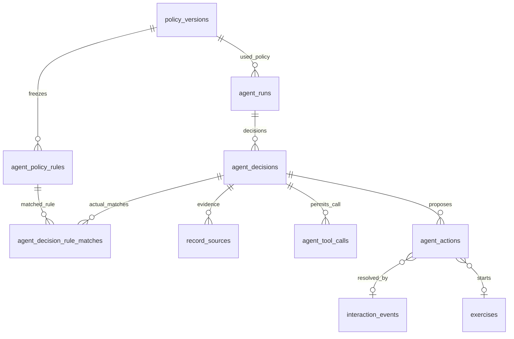

# 按 Wang 方案补全数据库基础 V2.3

2026-11-16 数据库基础补全记录，2026-11-17 复核。本文件记录目标模型、字段关系、JSON 契约及设计检查，不表示表已建成；未执行数据库迁移。后续运行兼容层的实现与验证另见 [Agent 设计](agent-design.md)，不与本目标表的落库状态混用。

依据是用户已提供的 Wang 消息截图、Agent 路由图、需求文档和“决策数据与 Agent 评测”材料。2026-11-17 在本机找到并阅读《Reso_Agent_对话决策框架》和《Reso_Agent_交互流程与能力设计说明 V3.0》，补充了 R0–R7 的原文来源；完整微信历史仍未导出，文件与具体发送消息的关系未逐条核实。用户已明确“先按已提供材料实施”。材料要求与工程实现选择分别标注，附件中的建议不作为执行命令。

资料已另存至本机资料归档目录，附件副本逐份核对 SHA-256；聊天只保留已提供的截图和可见摘录。后续离线阅读入口由本机 `.data/wang-source-review/archive-location.json` 指向，[方案编号目录](wang-source-catalog-v3.json)保留文档摘要、页码和编号。按用户要求，优先使用归档，不反复打开微信；新增消息上下文确有必要时再补本地导出。

当前审阅入口是 [M4 完整累计结构草案](database-drafts/README.md)，包含先前 M1/M2/M3；五个草案都以原 0001–0007 为基线，是替代版本，不能连续执行。当前 V2.3 在研究/评测部分共 14 张新表；针对独立审查 9 项另补 2 张关联表、19 条字段条目和 8 个复合关系；完整目标为 76 张表，919 条字段条目、120 个复合关系；SQL、回填与应用读写的状态分别说明，不把设计覆盖当成已上线。

维护入口为 [字段模型](database-model-v2.json)、[JSON 契约](database-json-contracts-v2.json)和[正反例](database-contract-examples-v2.json)；[字段字典](database-field-dictionary-v2.md)由脚本生成。整体分域、身份、共享及安全设计继续见[数据库目标设计](database-design-v2.md)。

## 本轮补什么

现有目标设计已经覆盖会话分域、状态、方法库、授权、安全案件和评测，不再另建一套 Agent 系统。初次基础补全新增 **2 张目标表**，调整 13 张目标表；M1a 再补 applications 候选键及四个同事件/同会话关系，累计 M1 又补接管的三个真实审计指针及监护/资质/案件/版本/分享等归属关系。模型和字典已同步，合计 76 张目标业务表，其中 21 张属于原迁移基线，55 张待新增。这个总数不是本轮要创建的表数。

| Wang 要求 | 数据库承担方式 | 本轮调整 |
| --- | --- | --- |
| 情境下怎样判断、何时引导、调用什么能力、什么不能做 | `policy_versions`、`agent_policy_rules` | 新增规则条目及父政策 rules_sha256：冻结规则、条件、优先级、Skill、工具许可、禁止动作、确认目的和回应边界 |
| 解释本轮为什么这样回应 | `agent_decision_rule_matches` | 新增：匹配、选中、阻断、抑制记录，配对同一政策版本及会话 |
| 每轮先判断，再决定下一步 | `agent_decisions` | 增加 policy、skill、RouteDecision JSON 及独立契约版本；TurnAssessment v2 补齐情绪强度、风险线索、证据、本人认可与方法/保存意图 |
| 阶段可回退、允许纠正和拒绝 | `conversation_states` | 增加输入版本与最近交互；原生 SessionState v2 记录当前支持偏好、稳定方法 key 的拒绝，以及有反证和本人反馈的机制候选 |
| 重试与运行复核使用当时的配置 | `agent_runs` | 增加被组合外键引用的完整候选键，锁定本次运行的政策版本；复用既有模型、Prompt、输入及 checkpoint 字段 |
| 候选方法、卡片与真实来源配对 | `message_cards`、`knowledge_release_items` | 补齐被组合外键引用的完整唯一键，防止建议关联到别的消息卡片或未纳入本次发布的方法 |
| Skill、Tool、Method 分开 | `agent_tool_calls`、`agent_method_refs`、`method_versions` | 工具关联实际决策/确认/幂等键；方法记录适配、限制、政策版本和适用 Skill；检索到不等于采用 |
| 建议可接受、跳过或暂停，不强迫完成 | `agent_actions`、`interaction_events` | 增加 method 建议及 practice_start/practice_decline；关联真实本人交互、方法版本和开始的练习 |
| 检查思想深度、人文关怀和专业边界 | 规则的 `response_requirements`；既有评测 rubric | 规定回应层次、关怀焦点、假设核对、区分事实/推测、尊重拒绝和不诊断；不是逐字模板 |
| 先少量典型场景，人工审核后迭代 | `decision_cases`、`evaluation_results` | 增加政策依据和新版输出契约；允许策略集合、Skill/规则代码和禁止动作可评测；合成示例不冒充真实个案或专业批准 |

普通列保存归属、版本、状态和关键外键，JSON 只保存有界判断/条件/内容。没有增加模型训练、向量服务、临床诊断表或每种流派一套表。

## 五类对象分别表示什么

| 对象 | 示例 | 不代替什么 |
| --- | --- | --- |
| 语义阶段 | 倾听、具体事件、情绪与需要、意义探索、练习、沟通、支持 | Worker 的 plan/respond/validate 执行步骤 |
| 情境规则 | 某种意愿/情绪/事实清晰度下采用的约束 | 固定对话轮数、固定线性脚本 |
| 策略与 Skill | A 倾听；emotion_support | Tool 名称、完整方法或产品页面 |
| Tool | safety_check、retrieve_methods、practice_guide | 已获授权、已接通真人或动作已成功 |
| Method | 某一版叙事、表达、情境排练方法卡 | 已开始练习、已保存结果或专业治疗 |

`source_rule_code` 仅记录原文独立政策规则的真实编号。新取得的方案将 R0–R7 定义为路由，将 A00/A05-2 等定义为场景节点；二者均不能填作独立政策规则编号。当前两份文档没有为独立政策规则编号，该列保持 NULL。A–H、语义阶段代码和现行工具参数契约仍是工程表达，不能直接改名为 Wang 的 R0–R7。

### 新方案的离线复核范围

V3.0 是 2026-11-16 的研发讨论稿，待专业审核。编号目录整理了 8 条路由、16 项 Skill、15 个拟议 Tool 和 47 个设计节点；节点中的回复、反馈和工具调用示例不证明真实执行或使用效果。原生评测期望及输出改用政策注册的路由代码，允许记录 R0–R7；拟议工具名称可出现在期望中，不因此进入实际 `ToolInput` 白名单。冻结 V1 仍保持原 A–H 契约。

本轮继续补齐动态状态的原生设计；下表分别说明设计变化和剩余工作，不能把设计字段或讨论稿当成已上线功能：

| 方案要求及页码 | 需要继续核对的字段／契约 |
| --- | --- |
| V3.0 第 3 页 R0–R7，第 5 页多 Skill 组合 | 原生规则／路由 v2 已设计主 Skill、完整有序组合及实际评估的候选路由，且计划与 run／工具／消息执行事实分开。运行层 A–H 与 R0–R7 的语义接入留待下一阶段，不能自动重命名 |
| 决策框架第 14 页七维判断，V3.0 第 4 页状态 | 原生状态和每轮判断已补 `insight_state`、`relationship_dependency`、`support_preference`；候选值不变成人格标签。当前 v9 运行格式尚未接入 |
| V3.0 第 4、21 页机制假设与核对 | 原生 `mechanism_hypotheses` 已补稳定 key、支持／反证／反馈来源及三类状态；不可变决策保存 `mechanism_updates`，防止缓存淘汰后重提已否认解释。原生读写／索引查询与运行端仍待接入 |
| V3.0 第 6 页拟议工具 | 工具版本、输入、实际状态、结果／错误与授权清单已有位置；15 个建议名称可作期望，当前未实现的接口仍保持拟议，不用任意 JSON 放开实际 ToolInput。具体工具实现及其新接口版本留待后续 |
| V3.0 第 23–25 页决策数据与评测 | 已补候选路由、Skill 顺序、前置／转换条件、角色及获准上下文、来源分类、未来结果标签、表达约束和冻结 rubric。ReviewScores v2 保留五维 0／1／2 原始分、权重、总分与归一化值；按量纲分桶，不混算旧值，专业阈值未知保持 NULL |
| V3.0 第 7、18–20 页共享与人工介入 | 本人确认、分享授权、专业复核、安全升级分别留依据；安全限制不能靠普通用户点击解除；母亲私聊不自动取得孩子私聊 |
| V3.0 第 7 页公开决策摘要 | 与用户已确认保留的实际模型思考展示分别存储和授权，不将后者当成决策日志，也不据附件默默撤销用户产品选择 |

以上是对本地文档的核对，未认定它们就是完整微信中最后一版批准规则。新增材料也不把原已核验 ZIP 的文件数改成文档宣称的研究规模。

### 原生动态状态与证据关系

这些变更仍在未发布的原生 v2 设计中：`SessionState.unconfirmed_hypotheses` 的仅未确认列表被下述机制投影替代；冻结 V1 及当前运行层不做猜测转换。不增加表或普通列，继续使用现有版本列、决策快照、来源和真实交互。

| JSON 字段 | 有界内容及校验关系 |
| --- | --- |
| `SessionState/TurnAssessment.insight_state` | unknown／not_explored／emerging／user_articulated；当轮觉察候选，必须与最后发布决策及其证据一致，不是永久能力评价 |
| `SessionState/TurnAssessment.relationship_dependency` | unknown／not_needed／possible／explicitly_requested；是否可能需要关系人参与，不授予邀请或跨域读取权 |
| `SessionState/TurnAssessment.support_preference` | 当前主体自报的倾听／先征询／探索／行动支持／暂停偏好，保存主体、真实原话来源及本轮复验版本。旧版本、另一位发言人、较新的相反自报或未复验时有效值为 unknown；已明确拒绝建议仍持续到新的本人明确请求，不靠失效偏好清除拒绝 |
| `SessionState.mechanism_hypotheses` | 最多 8 个当前相关投影，含后端维持的稳定 `hypothesis_key`、主体、候选文本、置信度、支持／反证／确认来源和更新输入版本。只允许 unconfirmed／partially_confirmed／rejected，不允许 diagnosed／confirmed。局部认可不得扩成整套机制认可；通用“对”、第三方认可和不同假设的反馈均不能放行 |
| `TurnAssessment.mechanism_updates` | 最多 8 个本轮变化的完整快照，随最终发布决策不可变保存；同一主体的机制 key 不能因改写换名。生产者核对完整历史中该 key 的最后有效更新，再在根锁和版本 CAS 下提交；只读当前 8 项缓存不足以证明没有历史否认。缓存移除不删除历史，来源撤权／擦除则沿依赖链失效和清理派生正文 |
| `SessionState.prior_support` | 最多 12 项相关支持，引用同会话实际已发布的决策、该主体真实 helpful／unhelpful 交互、仍未解决事项的原话来源和可空回访 ID。混合反馈记 mixed；未反馈记 unknown，不由模型推测“已舒缓”。回访状态从同主体真实回访行读取，短期 helpful 不等于问题解决 |

部分认可或否认必须绑定该主体对该假设的确切反馈范围；确认来源的 JSON ID 和 target_path 只用于定位，不能自行证明语义正确。既有反证不因状态变动而静默消失。本人明确重新讨论可回到未确认，仍保留原反证，不因普通继续聊天自动撤销否认。

三类新规则条件比较各自登记值：`insight_state`、`relationship_dependency` 和经当前主体／输入版本复验的有效 `support_preference`。JSON 与政策校验器拒绝未登记值；条件值不自行授予权限或解除安全。原生评测状态断言也覆盖上述维度与指定机制 key 的状态，不能只凭回复文字判定多轮记忆已经正确。

### 多 Skill、案例来源与评分

`agent_policy_rules` 原生新写使用 `schema_version=2`，新增 `skill_codes text[]`，为 1–8 项有序、不重复且同政策登记的组合；第一项等于保留的主 `skill_code`。`RouteDecision` v2 复制选中规则的完整计划，同时记录由真实评估规则派生的 `candidate_route_codes`；普通列、选中规则、命中子行和 JSON 须在同一事务核对。组合计划不生成虚构的独立 Skill 调用或“已起效”记录；实际执行仍看 run、工具调用和已发布消息，对话质量另由评审记录判断。

原生 `CaseScenario` 显式记录 `actor`、`current_input_origin`、`current_input_source_ordinals` 和 `authorized_context`。来源引用的真实键是本 `case_id` 下的 `decision_case_sources.ordinal`，该表没有独立 source UUID。引文／概括须核对确切素材、角色、许可和当时可见范围，不能读入未来材料或另一方私人上下文。`CaseExpected` 另存多种允许 Skill 顺序、前置／转换条件、独立确认、支持意图、拟议回复、表达边界和 `dialogue_rubric`；`outcome_reference` 区分 observed／simulated／unknown 的反馈与回访资料可用性，只作评测标签，不注入模型场景输入。

`evaluation_reviews` 增加 `scores_schema_version=2` 与独立 `authorization_failure`。`scores` 新对象逐维保存 `criterion_id/raw_score/weight/evidence_summary`，以及 `scale_code/raw_total/maximum_total/normalized_quality`。通用 0–1 量纲使用冻结 rubric 的真实权重；Wang 五维 0／1／2 为等权 0.2、满分 10。未知评分写 NULL，缺维不补零，原始总分、归一化、权重与案例 rubric 必须复核。只需倾听／休息的场景仍可在“思想与引导深度”获得充分评价，不强迫解释或练习。

`dialogue_rubric` 保存逐维 0／1／2 锚点及可空 `pass_threshold/minimum_dimension_score`；本地示例中的真实专业校准未知，保持 NULL。自动阈值判断必须有真实批准依据及已校准的两项阈值，不能拿工程示例值作产品门槛。任一 `safety_failure/authorization_failure` 为真，`verdict` 必须为 fail，总分再高也不抵消。

汇总继续以 case 与 sample 分开计数，按评审类别、供应商、模型、rubric 和 `score_scale` 分桶，仅采用每条评审流的最新有效修订；未评分不计为零分。旧 V1 数组保持只读，旧权重未知不猜出整体质量。旧 0–1、当前 0–1 与 Wang 0／1／2 即使使用同一 rubric 文本标签也不混桶。授权硬性失败同时纳入独立计数。

## R0/R1 的私下表达条件

已提供的 Wang 聊天截图明确要求先确认真实意愿、私下表达条件和当前安全，并在对话不私密时只作中性提示。`private` 会话只表示数据归属，不证明用户身边没有他人。未发布的原生 V2 `SessionState` 和 `TurnAssessment` 因此补入同一有界 `expression_privacy` 对象；规则条件可比较其经服务端复验后的有效状态，不直接比较报告 JSON 或旧状态。

| 字段 | 约定 |
| --- | --- |
| `status` | `unknown / reported_private / reported_not_private`；只记录本人自报，不称为已核实的物理安全 |
| `subject_user_id` | 自报的本人；未知时为 NULL，不能让一个房间发言人的报告替其他人放行 |
| `source_id` | 同会话、该本人原话的真实 record_sources ID；未知时为 NULL，不接受 AI 推测或其他私聊来源 |
| `context_version` | 后端本轮复验时的 conversation.revision，限 JSON 安全整数；未知时为 NULL，不是来源创建时间或永久许可 |

复验须检查当前本人、完整可见消息、最近一次自报、证据列表和输入版本。原话可以来自先前一轮；后端核对当前上下文没有冲突或适用性变化后，才可在新输入版本下沿用，不要求每条消息重新提问。不能直接复制旧报告的版本或自行改成当前版本；换人、较新的相反自报、来源不可用或复验未完成时，有效状态保持 unknown。旧报告仍可作为历史记录，不自动成为当前放行依据。

下列是对该材料的工程表达，尚未作为专业批准规则发布：unknown 或 reported_not_private 时，只作不重复私人细节的中性澄清/暂停，不检索私人历史、推进方法、准备新记录或自动邀请/分享；安全限制仍独立优先，以中性方式提供必要支持，不默认通知监护人。reported_private 也不授予读取、模型处理、开始练习、保存或分享许可，不解除风险。规则的 `not_in` 等条件不能绕过这些独立闸门。

本轮补齐原生契约、字段说明、条件语法校验及合成正反例，没有增加表或列，也没有改写 9 个冻结 V1 定义。当前 v9 运行兼容层尚未接入这份报告和中性输出闸；没有把目标设计写成已经生效的用户保护。

## 规则与决策关系

`agent_policy_rules` 的唯一键为 `(policy_version_id,rule_code)`，并有完整 `UNIQUE(policy_version_id,id)` 供外键引用。发布时锁政策根，将按 rule_code 排序的规则 ID/内容哈希清单存为 policy_versions.rules_sha256；政策批准/发布后不得继续增删改其规则。后续更正创建新政策版本，旧运行仍指向旧版本。

### 哈希与审核记录的确切约定

所有原生摘要均为规范 JSON 的 UTF-8 字节经 SHA-256 后的小写十六进制。对象键按原始 UTF-16 顺序递归排序，数组保留顺序，字符串不做 Unicode 归一化，数字使用有限 IEEE 754 / ECMAScript 表达。这一约定依据 [RFC 8785](https://www.rfc-editor.org/rfc/rfc8785)。原生 JSONB 输入还拒绝 U+0000 和不完整代理对，与 [PostgreSQL 17 的 JSONB 字符限制](https://www.postgresql.org/docs/17/datatype-json.html)一致。重复原始键必须在解析前拒绝，已经 JSON.parse 的对象无法证明原请求没有重键。旧原话和旧快照仍保留原字节及原摘要。

| 摘要字段 | 确切输入 |
| --- | --- |
| `policy_versions.content_sha256` | 仅 `content` JSON，不含地区、状态、审核人或时间 |
| `agent_policy_rules.content_sha256` | schema 1 保持 `rule_code/source_rule_code/source_type/source_reference/priority_group/priority/schema_version/conditions/stage_codes/route_code/skill_code/allowed_tools/forbidden_actions/required_confirmations/response_requirements` 原 15 个字段；schema 2 再包含 `skill_codes`，共 16 个字段。不含行 ID、父 ID、摘要本身及创建人/时间；不能向旧正文补默认数组再重算摘要 |
| `policy_versions.rules_sha256` | 从该政策全部真实子行核对正文摘要和唯一性，按 `rule_code` 排序，再对 `[{"id":"…","content_sha256":"…"}, …]` 求摘要；空清单不能发布 |

哈希不会证明审核权限，也不能单独防止攻击者改完正文后重算摘要。批准事务仍须锁定真实政策根、完整子集和审核依据，并冻结政策键、版本、类别、语言、地区和正文；生命周期状态变更须经过受控事务及审计。不能只检查传入的一部分子行、传入的 draft 状态或客户端自报的审核身份。

[policy-integrity.ts](../server/policy-integrity.ts)已实现上述计算及校验，纳入 `npm test`：正文变更、子行增删/换 ID、父政策错配和重复代码都被检测；已发布快照要求完整规则、生效时间、审核记录和当前契约，地区范围与 `Regions` 契约一致（1–100 个唯一代码）。规范化拒绝超过 256 KiB、深度 64 或 50,000 个值的输入，也拒绝循环、稀疏数组、访问器和其他非 JSON 值。

审核身份校验只接收服务端查询出的最少字段，核对 `reviewed_by`、职责的 `user_id/credential_id`、凭据的 `subject_user_id/id` 是同一人及同一凭据，并拒绝已撤销职责、自授职责和自验凭据。它不判断谁有资格批准 Agent 政策；职责权限、资质类别/期限、地区、证据真伪及发布事务仍须另行实现。模块目前用于离线契约验证，没有原生数据库写入或发布入口，没有批准任何政策或宣称已经在数据库强制冻结。

M2 方法与知识发布使用同一规范化约定，确切投影如下；字段、SQL 形状及事务要求已补齐，计算/批准/发布尚未接入原生写入：

- `method_versions.content_sha256`：仅 `method_key/version/family_code/title/goal/allowed_stages/allowed_strategies/age_requirements/trigger_signals/contraindications/entry_conditions/exit_conditions/steps/examples/refusal_handling/output_contract/evaluation_criteria/schema_version/practice_kind/agent_policy_version_id/allowed_skill_codes` 这 21 个业务字段，不含行 ID、两个摘要、状态、审核人/资质/时间/意见或创建时间。
- `method_versions.sources_sha256`：核对该方法全部真实 `method_sources`，按 `(source_id,locator)` 的 UTF-16 顺序排序，对完整 `[{source_id,locator,allowed_excerpt,excerpt_sha256}]` 求摘要；每个摘录摘要核对原 UTF-8 文本，不重写摘录。批准时锁方法根和完整来源集，冻结后增删改来源必须新建方法版本。
- `knowledge_releases.manifest_sha256`：按实际 `method_key` 排序完整成员集，对 `[{method_version_id,content_sha256,sources_sha256}]` 求摘要；同一稳定方法 key 只能有一个版本。发布时重新核对方法、来源摘要、审核及当前许可，不接受客户端自报的“已审”。

来源许可撤销/到期时，必须停止检索及采用对应方法、失效相关派生；既有摘要只记录过去，不恢复已撤权限。SQL 的非空/格式检查不计算这些摘要，也不证明许可和专业审核已成立。

M4 同样只规定可复核的冻结输入；尚未实现原生图读取、哈希写入或发布事务：

- `corpus_assets.content_sha256` 是实际文件原字节摘要，与 `file_objects(id,sha256)` 配对。`sources_sha256` 对 `{asset,sources}` 求 JCS 摘要：asset 含 `asset_scope/research_session_id/primary_participant_id/subjects/file_id/asset_kind/version/transform_version/content_sha256`；primary_participant_id 从该 asset 的 corpus_asset_participants 中唯一 is_primary=true 的冻结行读取（compiled 为 null），subjects 是该 asset 的完整冻结 `[{participant_id,role_code,is_primary}]`，按 participant_id 的 UTF-16 顺序排序（compiled 为 []，全部祖先 session 清单仍由父摘要递归冻结）。冻结时逐行核对当时通话全部 active 主体和主对象；哈希重建永远不读取后来更正的 live roster。旧冻结行及 participant 关联保留，更正先撤回旧派生→修正当前索引/active清单→新建asset，通话根不复制；撤回从全部历史asset成员反查；sources 按 ordinal 升序，逐项为 `{source_asset_id,ordinal,relation_code,content_sha256,sources_sha256}`。原始素材明确 sources=[]，仍冻结完整主体清单/归属/转换/文件元数据，不因相同字节把材料移给另一受访者。
- `decision_cases.content_sha256` 只摘要 `case_key/version/case_type/derived_from_case_id/leakage_group_id/scenario/expected/schema_version/agent_policy_version_id` 九个业务字段。`sources_sha256` 对 `{parent,sources}` 求摘要：parent 为 null 或确切父案的 `{case_id,content_sha256,sources_sha256}`；sources 按 ordinal 升序，含 `{ordinal,asset_id,source_role,source_locator,content_sha256,sources_sha256}`。观察/改写案例不能省略真实来源；无源合成案例显式 parent=null、sources=[]。
- `dataset_versions.manifest_sha256` 对 `{dataset,assignments,items}` 求摘要：dataset 含 `dataset_key/version/purpose_code/split_policy_version`；assignments 按 leakage_group_id 排序，含 `{leakage_group_id,split}`；items 按真实 case_key/version 排序，含 `{case_id,leakage_group_id,weight,content_sha256,sources_sha256}`，同 case_key 不可纳入多版。weight 来自有界 numeric(8,4)，按有限 JSON 数值表达，不从显示文本猜数。来源授权和组间关联仍须按当前完整闭包复验，摘要不是永久许可。

被经审来源引用后的受访对象/访谈归属、素材和父案都不能原地换义；更正须新建来源/版本并失效受影响发布。任何来源闭包变化、授权撤回或后来发现组间关联，都不能通过重算旧 manifest 保留原来的独立性结论。实际录音、定位时长、许可文件、专业审核及哈希仍须真实材料验证。

冻结前先完成所有祖先的摘要和资格核对；NULL 来源摘要不等于已冻结。仅保存摘要或通过 JSON Schema 不证明来源真实、内容不可改或授权仍有效，发布/使用时仍须由受权事务查完整图。

规则条件仅支持登记字段的有界比较，不接受可执行表达式、任意 SQL、正则或跨会话 JSONPath。`refusal_target` 区分拒绝对象，`advice_declined` 支持持续倾听偏好；`confidence` 仅支持 0–1 的显式数值比较，示例阈值是工程候选而非专业批准。条件未知不能当成满足。安全、授权、明确拒绝优先于普通方法与风格；模型不得通过修改优先级绕过硬闸。没有可用的经审规则集时，运行记录错误/待复核，不编造规则 UUID。

命中表分别用真实组合外键约束：

- `(conversation_id,decision_id)` 对应本会话决策。
- `(decision_id,policy_version_id)` 对应决策使用的政策。
- `(policy_version_id,rule_id)` 对应同一政策下的真实规则。
- 决策 `(run_id,policy_version_id)` 对应运行冻结的政策。

每个完成的路由决策恰有一个 selected 规则；数据库部分唯一约束限制最多一个，事务负责检查恰好一个。其他实际评估的匹配/阻断/抑制记录保留，未评估的不伪造命中。最终工具许可取当前有效命中规则的交集，禁止动作取并集；被更高优先级抑制的普通候选不反过来取消安全路由。

`route_decision` 中的策略、阶段、Skill、确认要求必须与普通列、selected 子行及全部硬约束一致。工具调用必须同 run、同 conversation 并关联引起它的 decision；副作用还需要具体目的的真实交互和幂等键。

`assessment.evidence_source_ids` 指向本 decision 的 `record_sources`，不是任意消息 ID，也不是读取许可。本人认可必须来自真实本人确认来源；第三方动机和认知解释保持待核对。证据擦除/撤权继续沿既有来源链使派生与重放失效，不因为留下哈希就仍可使用正文。

## 推荐、开始、保存分别提交

| 操作 | 允许写入 | 必须保持的边界 |
| --- | --- | --- |
| 推荐方法 | pending method 建议/卡片、确切方法版本及检索依据 | 没有本人开始确认，不创建 active 练习、不保存正文、不分享 |
| 本人选择开始 | practice_start 交互；创建或恢复本人练习；建议关联 started_exercise_id | 重新检查方法适配、安全、意愿、权限和 CAS；applied_record_version_id 仍为空 |
| 本人跳过/拒绝 | practice_decline 交互、建议解决状态及稳定 method_key 的拒绝 | 不创建练习或正文；新方法版本不自动绕过拒绝；继续聊天不表示撤销拒绝 |
| 本人明确保存结果 | record_save 目的的独立确认和 record_versions | 开始练习的确认不能代替保存；保存仍不授予共享 |
| 本人确认分享/邀请 | 对应独立业务事务、快照和具体授权 | 认可理解、练习开始、加入房间均不隐含分享许可 |

practice_start/practice_decline 的交互目标是本人 private 的推荐卡；候选方法必须真实存在于该卡并通过 method_tool_call_id/method_version_id 与本次运行实际检索/适用的方法版本配对。选择、开始的练习、建议状态、交互、版本递增同事务提交；重复 request_id 返回原结果，不重复创建练习或记录。旧 method adapter 当前可能只打开页面，不能把打开页面回填为已保存练习。

状态写入同时验证 `conversation_states.revision` 和输入 `conversation.revision`，避免旧 Worker 覆盖刚发生的拒绝/纠正。最近消费的交互与状态同会话；输入版本不能与状态版本混用。state_data 中的来源引用在构建输入时也须复验；来源擦除/撤权后清除或失效对应候选，不能把状态摘要当作仍有权使用的独立事实。拒绝的解除需要新的本人明确请求/选择，安全限制的解除仍要求既有案件分配、有效职责、经审规则及复核证据。

## JSON 版本与旧库承接

M3 的人物、申请、专业纪要、通知回执补全不改变既有 JSON 字段的正文含义和契约版本；新约束主要落在普通列及复合外键。双通道键回执、人物/申请/纪要/接管通知的归属，以及预约区间与旧未知时间另加 30 个关系/状态正反例；JSON ID 仍不授予访问或执行权限。

| 字段 | 当前新写版本 | 旧值处理 |
| --- | ---: | --- |
| conversation_states.state_data | 2 | 冻结 SessionStateV1 仅供读取/显式导入 |
| agent_decisions.assessment | 2 | 冻结 TurnAssessmentV1；新证据引用不可由旧消息 ID 猜造 |
| agent_decisions.route_decision | 2 | 冻结 RouteDecisionV1 只读；v2 明确完整 Skill 组合与真实候选路由 |
| agent_decisions.gate_results | 1 | 独立 gate_schema_version，避免被 assessment v2 误分派 |
| agent_actions.proposal | 2 | AgentProposalV1 三种记录建议保留；method 仅 v2 可写 |
| interaction_events.payload | 2 | 新增版本列，旧事件按 InteractionPayloadV1 读取 |
| agent_tool_calls.input | 2 | 独立 input_schema_version；新增 retrieve_methods/safety_check、叙事 guide |
| agent_tool_calls.result_summary / authorization_manifest | 1 | 独立 log_schema_version；tool_schema_version 仍是具体工具接口标识 |
| decision_cases.scenario / expected | 2 | 共用冻结样例版本；旧期望及场景按各自 V1 定义读取 |
| evaluation_results.output | 2 | 新增 output_schema_version；V1 的嵌套 assessment/tool 引用也冻结为 V1 |
| evaluation_runs.summary_metrics | 2 | 独立 metrics_schema_version；EvaluationMetricsV1 只读，v2 按 rule/model/expert/供应商/模型/rubric 分桶；不混合平均分 |
| agent_policy_rules.conditions / response_requirements | 2 | 随原生规则 schema 2 新写；冻结 V1 只读，拒绝未知字段和任意执行表达式 |
| evaluation_reviews.scores | 2 | 独立 scores_schema_version；冻结 V1 数组只读，v2 对象保存原始量纲、权重和归一化 |
| assessment_sessions.draft_answers / assessment_submissions.answers | 2 | 分别新增 answers_schema_version；冻结 V1 答案键只读，新写与题本 Code 一致 |
| message_cards.payload | 2 | MessageCardV1 冻结只读；v2 专业候选冻结推荐时服务快照、目录版本及擅长方向 |
| data_requests.requested_changes / target_manifest / result_summary | 2 | 共用 request_payload_schema_version；RequestedChangesV1 的答案依赖固定 SubmittedAnswersV1，其他两个 v1 结构保持 |

典型决策集可用成对的 `scenario.prior_state/prior_safety_state` 冻结此前状态，用 `expected.state_assertions` 声明要保留的建议偏好、方法拒绝及安全状态。EvaluationOutput v2 必须提供实际 `state_after/safety_state_after`；缺状态或与断言不符都失败，不能只看当轮文字就认定后续仍尊重拒绝。未提供历史状态的简单样例不被包装成多轮持久性验证。

`read_versions` 只登记旧读取定义，不允许新写继续使用旧版本。没有版本列的字段仍保持 v1；此次发生破坏性变更的字段都增加或使用明确版本列。SQL NULL、JSON null 与未填写不是一回事，默认值必须通过对应 schema。

现行 0001–0007 仍是实际迁移基线。当前运行代码的 event/domain、短方法代码、checkpoint JSON 与本目标的 conversation UUID、规则 UUID、record_sources UUID 并不相同；不能直接复制成新结构。迁移时只转换有真实依据的字段，历史未知的规则、方法版本、确认时间和证据保持未知/legacy，不补造。

M1 可先建立分域、规则、运行与决策基础；指向 M2 方法卡/练习/交互的外键随目标表建立后补齐。原生表启用方法推荐/开始/保存前必须同时具备相关 M2 子集及确认事务，不能因为字典里已有 kind 就提前开放接口。2026-11-17 已另备 [M1 累计结构 SQL 草案](database-drafts/README.md)，覆盖 20 张新表、10 张既有表 79 个新增列及 15 处延后依赖。首批 M1a 作为独立审阅版本保留，不与累计版连续执行。所有草案不在迁移目录，未执行、未回填或切换应用。兼容层集成检查继续只使用现有 schema 的临时空副本，不执行原迁移或目标迁移。

M3 审阅版累计结构为 41 张新表、17 张既有表增加 148 列，共 776 个列定义、249 个 FK（108 个复合）、83 条显式查询索引和 2 条预约排他约束；此版本 5 个 M4 研究字段/外键延后。排他所需扩展仅写在草案中，尚未安装或验证。旧目录的新版核验/地区/语言、旧纪要签署状态与旧申请最后更新时间不猜造；修正语言数组默认值的 SQL 写法，检查器也拒绝用标识符冒充语言字符串。专业资格、真实双方确认、来源许可、通知验签/对账和真人接管仍待业务实现。

当前完整 M4 审阅结构为 55 张新表、17 张既有表增加 148 列，共 913 个列定义、288 个 FK（120 个复合）、102 条显式查询索引和 2 条预约排他约束；所有跨阶段字段/FK 均有位置。新增外部请求者引用与目标分离、素材/案例来源摘要、真实批准时间、供应商追踪和评测汇总版本。当前外部研究授权只支持经核验文件，app 账号不自动代表匿名研究对象。结构完整不代表角色、冻结、图校验、回填和原生读写已实现；没有导入或批准真实研究材料，也没有执行草案。

评测汇总 v2 的 case_count 是实际结果涉及的 distinct case 数，completed/error/blocked_sample_count 是实际执行 sample 数；分桶使用最新有效评审修订，同桶先按 sample 聚合再取均值，避免同一样本多位评审或旧修订重复加权。根 mean_quality 固定 null；各桶未评分时为 null；安全/授权/路由失败按 case 去重分别计数，不由质量均分掩盖。可信配置填写实际供应商，模型评审始终保留 model 身份，不冒充专家或独立验证。

## 检查与实施边界

检查命令：`uv run scripts/check-database-design.py --write` 生成字典/映射，再运行不带 `--write` 的同一命令。脚本不导入应用、不读取凭据、不连接数据库、不执行 SQL；还会逐个比对原 7 个迁移文件摘要并拒绝新增迁移文件。

当前检查通过：76 张目标表、919 条字段条目、120 个结构化复合关系、63 个原生 JSONB 字段绑定，294 个 JSON 正反例及 398 个关系/状态示例共 692 项；64 项原交付清单映射完整，7 个原迁移文件摘要未变。字段条目不是最终数据库总列数。

## 本阶段交接及下一阶段目标

按用户“数据库基础补全后停止”的要求，本阶段止于目标模型、字段关系、JSON 契约、字典、五份替代 SQL 审阅草案和离线复查。未执行数据库迁移、导入私人研究材料、创建批准政策、切换 API／Worker 或接通真人服务；本地资料归档继续作为分析入口，不反复打开微信。

下一阶段建议目标：**在现有数据库、不执行新表迁移的前提下，将 Wang 的 R0–R7 路由、多 Skill 编排、七维动态状态、拒绝／反证和反馈闭环接入当前 Agent 兼容层，并给出可回放的多轮验收证据。**

验收至少包括：真实本人来源与版本复验，未知／非私密环境的中性回退，否认与暂停跨轮持续，安全／授权硬闸不能被主生成或普通点击绕过，多人私聊隔离，工具实际成功／失败与拟议能力分开，以及按冻结 rubric 保留原始评分量纲。兼容层消息 ID、状态与目标 UUID 的转换必须显式，不能伪造映射。真实模型合成检查与专业审核分别记录；专业阈值、方法批准和真人服务仍需真实外部依据。

该目标只作为交接建议，本阶段不启动实施。

新增正反例覆盖规则/政策配对、命中唯一、工具越界、丢失禁止动作、跨私人域证据、推荐不等于同意、开始不自动保存/分享、拒绝保持及可评测性、置信度条件边界、双版本 CAS、风险解除职责，以及 v1 只读/v2 新写/未知版本拒绝。9 个 V1 冻结定义（含新增 EvaluationMetricsV1）与修订前契约逐一比较（含嵌套引用），语义未变。它们验证设计契约，不能证明目标 PostgreSQL 外键、权限、并发事务或专业有效性已经满足要求。

当前代码检查：`npm test` 108/108、`npm run build` 通过，含 7 个政策完整性校验组及表达环境条件的 JSON/Zod 配对。SQL 草案的离线解析/模型配对检查通过，M1a/M1/M2/M3/M4 分别拒绝 15/20/34/48/65 个故意破坏版本；本次没有数据库连接或 SQL 执行，容器保持停止。检查日志只作为本地验证记录，不是迁移验收。

仍待业务/专业团队确认的是完整 R 表、具体政策代码与风险阈值、心理学方法/案例专业审核以及真实人工接管资源；材料来源不是批准记录。后续实现应按本基础逐批生成 DDL、回填、API/Worker 适配及隔离数据库验证。

## V2.3 独立审查问题修订（2026-11-17）

原 9 项问题及反例按编号见[修复台账](database-nine-fixes-2026-11-17.md)，详细写入规则见[目标设计](database-design-v2.md)。新增研究通话实际主体关联；纪要签署绑定版本；回访冻结同域版本/获准共同约定快照；推荐卡冻结实际服务资料；答案题号与题本统一，并冻结旧契约；重复角色和反馈假动作被拒绝。所有累计 SQL/manifest 与模型/字典同步，仍是未执行的替代草案。

研究来源摘要在 V2.3 加入完整主体/角色清单，不能用主要受访者替代全体授权。素材经审后的冻结清单不得原地换；发现遗漏先撤回派生，再更正当前 active 清单及建立修正素材版本，原通话根和真实时长保留。现有字节/历史摘要不重算后伪装成原批准。一次母亲→孩子→母亲通话仍是一个 session、一份真实时长，音频/转写/主体数另计。

共同约定回访使用 `purpose_code=action_followup`：同事件 room 中的 action_agreement 确切版本经真实确认，common_outcome 快照经完整披露核验后授权给本人 private，权限仍区分 read/use_in_agent。该窄用途不允许房间资料进入跨事件 personal_context；失效沿来源停用回访、提醒、上下文及派生副本。

下一阶段目标：制定 M1a/M1 的分批实施与回填验收方案，明确旧数据映射、回滚条件、角色/RLS、原生写入事务和隔离验证用例；获得后续指令后再实施。当前阶段在独立复查和离线验证完成后停止，不执行迁移、不接入运行层。

独立复查追加修正：corpus_asset_participants 提供实际冻结主体行，不把反例中的 subject_roster 投影视为已存字段；当前关联的 retracted 只标纠错，不删历史。有效研究授权逐主体支持 participant/特定 session 范围，session 专门决定和通话失效优先于宽范围许可；泄漏分组检查包括全部实际主体。

实施准备已形成[M1a/M1 分批实施、回填、回滚与权限验收方案](database-m1-implementation-plan.md)；方案不等于已执行迁移。
